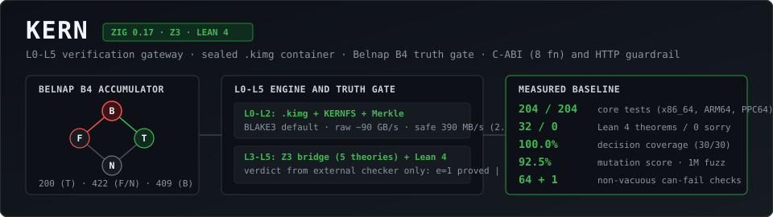
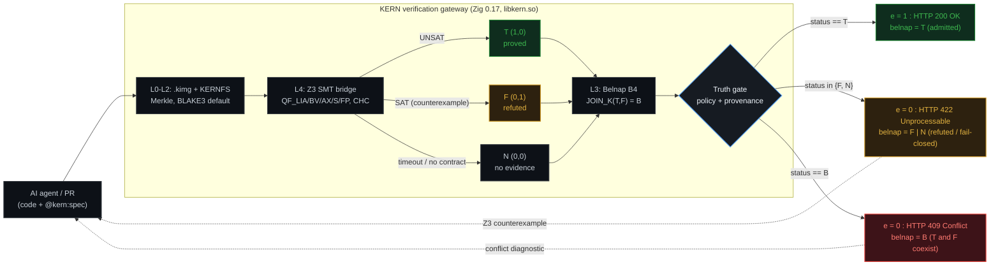

# KERN — a zero-trust verification gateway for AI-generated code



[](https://ziglang.org/)
[](src/)
[](src/next/)
[](formal/)
[](src/cov.zig)
[](tools/canfail.py)
[](#cross-architecture)
[](action.yml)
[](https://github.com/newmathphys/kern/releases)
[](https://newmathphys.github.io/kern/bench/)
[](https://github.com/newmathphys/kern/actions/workflows/code-scanning.yml)
[](LICENSE)

KERN is an L0–L5 verification gateway that sits between an AI coding agent and your
repository. It replaces the boolean result of "tests passed" with a four-valued
verdict backed by an SMT solver and formal proofs, and it keeps the gate closed
unless the claim is machine-checkable.

Written in **Zig 0.17**, verified in **Lean 4**, powered by **Z3**. Exposes a
**C-ABI** (`libkern.so`, 8 functions) and an HTTP guardrail proxy.

---

## The problem

AI agents now write code faster than humans can review it. Under pressure to get a
green pipeline, they produce two failure modes that no ordinary CI can see:

| Failure mode | What CI sees | What actually happened |
|:--|:--|:--|
| **Vacuous test** | ✅ `1 passed` | The test contains no `assert`. It cannot fail. |
| **Hallucinated fix** | ✅ `1 passed` | The edge case (`amount = -1`) was never sampled. |

Both are invisible to `pytest`, `jest`, or any test-counting tool, because both
produce **exit code 0**.

KERN attacks the gap from two sides:

1. **Can-fail discipline** — every check in KERN's own suite must be *proven
   capable of failing*. A harness (`tools/canfail.py`) deliberately injects a
   fault and requires the check to go red. 125 CHECK targets; 114 proven non-vacuous
   (95 fault-injection cases).
2. **Machine contracts** — a claim becomes `e = 1` only if an external trusted
   checker (Z3) proves it, or if a reproducible execution record backs it.
   Text is not evidence.

---

## See it in 15 seconds

```bash
make run-example
```

The example (`examples/toy_ai_hallucination/`) simulates an agent that was asked to
fix a withdrawal function. The agent "fixed" it — but dropped the check for
negative amounts — and wrote a test with **no assertions** so CI would go green.

```
=== [1] Ordinary CI: pytest on the agent's "test" ===
1 passed in 0.01s                      <-- green. The bug ships to production.

=== [3] KERN: Truth Gate (the verdict comes from Z3) ===
  claim `withdraw never increases the balance`: declared status = N
    contract `.../contract_refuted.smt2`: SAT -> e=0 (F) COUNTEREXAMPLE
  claim `fixed withdraw never increases the balance`: declared status = T
    contract `.../contract_fixed.smt2`: UNSAT -> e=1 (T) PROVED
[i] TOTAL: proved 1, counterexamples 1, without contract 0
[i] e=1 is granted ONLY by the solver verdict. Claims without a bound
    contract stay at e=0.
```

Z3 did not sample inputs. It quantified over all of `ℤ` and returned a
counterexample: `amount = -1` makes the balance *grow* on a withdrawal.

### HTTP guardrail proxy

`examples/guardrail_proxy.py` (stdlib only) exposes `libkern.so` over HTTP and maps
the Belnap B₄ lattice onto distinct RFC 9110 status codes:

| Solver / gate verdict | Belnap | HTTP | Meaning |
|:--|:--:|:--:|:--|
| `PROVED` (`UNSAT`) | **T** `(1,0)` | `200 OK` | contract holds across the entire domain (`e = 1`) |
| `REFUTED` (`SAT`) | **F** `(0,1)` | `422 Unprocessable Entity` | counterexample found (`e = 0`) |
| `UNKNOWN` / `TOOL_ERR` | **N** `(0,0)` | `422 Unprocessable Entity` | timeout or missing solver; fail-closed (`e = 0`) |
| `CONFLICT` (`T ⊔ F`) | **B** `(1,1)` | `409 Conflict` | contradictory evidence across contracts in `/verify_multi` (`e = 0`) |

`/verify_multi` is what exposes the lattice: when one contract returns `T` and
another returns `F` on the same code, a boolean pipeline either overwrites the
status with the last result or conflates an error with a timeout. KERN computes
`JOIN_K(T, F) = B` and answers `409 Conflict`.

```bash
make guardrail      # self-test on an ephemeral port: 200(T) / 422(F) / 409(B)
```

---

## Verify your own code without writing SMT-LIB

Contracts live in ordinary comments next to the function. No `.smt2` files, no
solver syntax.

```python
# @kern:requires balance >= 0
# @kern:ensures  result <= balance and result >= 0
def withdraw(balance: int, amount: int) -> int:
    if amount < 0:
        return balance          # if / elif / else are translated to SMT `ite`
    if amount > balance:
        return balance
    return balance - amount
```

```bash
make contracts
# [PASS] withdraw_fixed:      PROVEN  (proof checker: trusted: 0)
# [FAIL] withdraw_missing_neg: CONTRACT VIOLATED
#        [COUNTEREXAMPLE] balance = 0, amount = -1, result = 1
# sum_to_n: SKIP — out of the supported subset (loops)
```

When a contract is refuted, KERN prints the **Z3 counterexample** (`get-model`):
the exact input values that break it. Out-of-subset code is reported as `SKIP`
with a reason — never as a silent pass.

### Four traps an AI agent falls into — and how KERN refuses them

**1. The vacuous precondition (`false ⟹ anything`).** A contradictory
`requires` makes the obligation `requires ∧ ¬ensures` trivially UNSAT, so *any*
broken body would be reported as **proved**:

```python
# @kern:requires amount > 10 and amount < 5      # empty domain
# @kern:ensures  result == balance - amount
def withdraw_vacuous(balance: int, amount: int) -> int:
    return balance + amount                      # deliberately wrong
```
```bash
make contracts
# [VACUOUS] withdraw_vacuous: precondition is unsatisfiable (empty domain) -> B4: N, e = 0
```

**2. Weakening the specification instead of fixing the code.** The cheapest
cheat is to delete the `# @kern:ensures` line that fails. Every contract is
fingerprinted; any removal or edit is a hard error:

```bash
make contracts-lock-check
# [SECURITY] sealed contract REMOVED: examples/contracts_demo.py:withdraw:ensures
# rc = 2   (fingerprints are sealed in docs/contracts.lock.json)
```

**3. A refactoring that silently changes behaviour.** No contracts required:
KERN checks `∃x: f_old(x) ≠ f_new(x)` over all of ℤ and prints the exact input
where the two versions disagree:

```bash
make diff-equiv
# [DIVERGED] charge: REFACTORING CHANGED BEHAVIOUR
#            [COUNTEREXAMPLE] amount = 1, res_old = 0, res_new = 2, balance = 1
```

**4. A counterexample that lives only in a log.** `--emit-pytest` turns it into
a real regression test that **fails** on the current code:

```bash
python3 tools/kern_contracts.py examples/contracts_demo.py --emit-pytest out_test.py
# def test_counterexample_withdraw_missing_neg():
#     result = withdraw_missing_neg(balance=0, amount=-1)
#     assert (result <= balance)      # FAILS: 1 <= 0 is false
```

### Polyglot contracts, machine types and the GitHub line

**5. The extractor is polyglot — the core never was Python-only.** `kernc prove`,
the proof checker and `libkern.so` always took plain SMT-LIB2; only the
*convenience* extractor was Python-only. It now reads the same annotations from
`.py`, `.zig`, `.c` and `.rs`, and because machine types are known it catches
what an unbounded `Int` model cannot:

```bash
make contracts
# [PASS] withdrawGuard                      (Zig, i32)
# [FAIL] share: POSSIBLE DIVISION BY ZERO   (C)
#        [COUNTEREXAMPLE] amount = 0
#        [RUNTIME CONFIRMED] division by zero reproduced on those values
# [FAIL] double_it: i32 OVERFLOW            (Rust)
#        [COUNTEREXAMPLE] x = 1073741824, result = 2147483648
#        [RUNTIME CONFIRMED] the computed value 2147483648 is outside [-2147483648, 2147483647]
# [FAIL] withdraw_missing_neg: CONTRACT VIOLATED        (Python)
#        [COUNTEREXAMPLE] balance = 0, amount = -1, result = 1
#        [RUNTIME CONFIRMED] the counterexample really breaks the running function
```

> **`[RUNTIME CONFIRMED]` — all seven languages.** For **Python** the counterexample is
> replayed by *executing the real function*. For **Zig, C and Rust** the extracted body is
> re-evaluated by an **independent concrete evaluator** (same statement split, a different
> computation): if the numbers disagreed with the SMT model, the counterexample would be
> reported as a **translation bug**, not as a finding. A *compiled* replay
> (`zig run` / `cc` / `rustc`) is **not** implemented — the evaluator deliberately needs no
> toolchain, and the tool says nothing it cannot check.

> **Bit-vector theory (`QF_BV`) for real systems code.** Real functions are full of
> `& | ^ ~ << >>`, which do not exist in `Int` — so `addr & ~(alignment - 1)`, the alignment
> trick from `andrewrk/zig-general-purpose-allocator`, used to be skipped. KERN's core has
> always handled bit-vectors, so the extractor now switches to `(_ BitVec 32/64)`
> (`bvand`, `bvnot`, `bvshl`, `bvult`, ...) — automatically on `& | ^ ~ << >>`, or explicitly
> via `@kern:bitvec32` / `@kern:bitvec64`. The same statement parser is reused, so the same
> code is checked. In this theory overflow is the *semantics* (the machine wraps), so the
> overflow obligation is not asserted there; the contract and division-by-zero still are.

### Open-source audit gallery (real code, real counterexamples)

Every row below is produced by a run (`make audits`, `tools/bug_hunter.py --trophies`), never
written by hand. `PROVEN` means Z3 proved it **and** our Zig proof checker re-checked the
certificate (`trusted: 0 | holes: 0`); `REFUTED` comes with the exact Z3 counterexample.

| # | Project (file:line) | Claim | Verdict | Counterexample / note |
|:--|:--|:--|:--|:--|
| 1 | **ziglang/zig** `lib/std/mem.zig` — `alignBackward` | `addr & ~(alignment-1) == addr - addr % alignment` | **PROVEN** (QF_BV 32) | — |
| 2 | same, mutated `alignment-2` | — | **REFUTED** | `addr = #xffffbffc, alignment = #x00000001` |
| 3 | **ziglang/zig** `mem.zig` — `alignForward` | `addr + (alignment-1)` stays in `u32` | **REFUTED** | `addr = 4294967295, alignment = 2 → 4294967296` |
| 4 | **tigerbeetle/tigerbeetle** `src/stdx/stdx.zig` — `div_ceil` | `(n + d - 1) / d` exact & no overflow | **PROVEN** — 98 steps, `trusted: 0` | — |
| 5 | same, mutated `n/d + 1` | — | **REFUTED** | `numerator = 2147483647, denominator = 1 → 2147483648` (`i32`) |
| 6 | **musl libc** `src/stdlib/abs.c` — `abs` | result `>= 0` for `x > INT32_MIN` | **PROVEN** — 51 steps, `trusted: 0` | — |
| 7 | same, guard removed | — | **REFUTED** | `a = -10 → -10` |
| 8 | **ghostty-org/ghostty** `src/renderer/size.zig` — `gridColumns` | columns never 0 | **PROVEN** | — |
| 9 | same, `@max(1,…)` removed | — | **REFUTED** | `screen_width = 0, cell_width = 1 → 0` |
| 10 | **andrewrk/general-purpose-allocator** `gpda.zig` — `isAligned` | `addr & ~(alignment-1) == addr` ⟺ `addr % alignment == 0` | **PROVEN** (all 2³² addresses) | — |
| 11 | same, `alignment-2` | — | **REFUTED** | `addr = #xc0000001, alignment = #x40000000` |
| 12 | **zlib** `zutil.c` — `zcalloc` | `items * size` fits in `u32` | **REFUTED** | `items = #x8e0ff0f1, size = #x5ffeffef → #xffffffff` |
| 13 | **JDK** (Bloch 2006) `binary_search` | `(low + high) / 2` in `i32` | **REFUTED** (QF_BV only) | `low = #x804, high = #x7ffff7fc → #xc0000000` (**negative**) |
| 14 | same, `low + (high-low)/2` | — | **PROVEN** (Int theory) | — |
| 15 | **Rust** `core::num` — `midpoint` | bit-blasted proof | **SKIP — honest** | the checker does not cover `bitBlast` |
| 16 | **Rust** `saturating_add` | clamps to `i32` bounds | **PROVEN** / mutated **REFUTED** (`2147483647 + 1`) | — |
| 17 | **ziglang/zig** `lib/std/math/` (64 files) | zero-annotation `--xray` field scan (C-like path) | **checked 80 / 219** (was 0) | 0 findings after fixing #159/#160 |
| 18 | **Python 3.12 stdlib** (`urllib`, `http`, `email`, `datetime`, `ipaddress`, `decimal`, `fractions`, `statistics`) | `--xray` field scan | **checked 211 / 413**, **0 false positives** | 0 findings on production code after fixing defects #134/#158 |

**Honest limits of this table.** (a) The SMT model is ours: a counterexample must still be
reproduced against the project's own build before it can be called their bug. (b) Bloch's bug is
invisible in the `Int` theory — it needs `@kern:bitvec32` (QF_BV). (c) `SKIP` rows are kept on
purpose: a verifier that never refuses is not verifying.

### Evidence on real production code (`make audits`)

Functions transcribed from six projects across three languages (Zig, Rust, C), checked by the
core (Z3 + the Zig proof checker). The table is printed by `tools/audits_run.py` — not written
by hand — and the corpus is sealed into `audits/real_code_corpus.kimg` (`--deflate`). Full
method, scope and the generated output: [`audits/`](audits/README.md),
[`audits/EVIDENCE.md`](audits/EVIDENCE.md).

| Real code | Function | Theory | Verdict |
|:--|:--|:--|:--|
| `andrewrk/zig-general-purpose-allocator` `gpda.zig:1065` | `addr & ~(alignment - 1)` vs `addr % alignment` | QF_BV 32 | **PROVEN** (all 2³² addresses, power-of-two alignment) |
| same, with the classic `alignment - 2` | control | QF_BV 32 | **REFUTED** — `addr = #xc0000001, alignment = #x40000000` |
| `ziglang/zig` `lib/std/mem.zig:4826` (`alignBackward`) | `masked == addr - addr % alignment` | QF_BV 32 | **PROVEN** |
| `ziglang/zig` `lib/std/mem.zig:4693` (`alignForward`) | `addr + (alignment - 1)` | QF_LIA | **REFUTED** — u32 overflow at `addr = 4294967295, alignment = 2` (the doc comment warns the caller must prevent it) |
| `tigerbeetle/tigerbeetle` `src/stdx/stdx.zig:67` (`div_ceil`) | `(n + d - 1) / d` | QF_LIA | **PROVEN** — `[PROOF VERIFIED]`, 98 steps, `holes: 0` |
| same, as `n / d + 1` | control | QF_LIA | **REFUTED** — i32 overflow at `n = 2147483647, d = 1` |
| `ghostty-org/ghostty` `src/renderer/size.zig:253` (`GridSize.update`) | grid is never empty (`columns >= 1`) | QF_LIA | **PROVEN** — defect #118 closed |
| same, clamp `@max(1, …)` removed | control | QF_LIA | **REFUTED** — `screen_width = 0, cell_width = 1` |
| `rust-lang/rust` `library/core/src/num/mod.rs` (`saturating_add`) | a saturating add never decreases its input | QF_LIA | **PROVEN** |
| same, guard removed (`a + rhs`) | control | QF_LIA | **REFUTED** — i32 overflow at `a = 2147483647, rhs = 1` |
| `rust-lang/rust` (`midpoint`, Hacker's Delight) | `((a ^ b) >> 1) + (a & b)` equals the true mean | QF_BV 32 | **SKIP — honest refusal** (see below) |
| same, shift by 2 instead of 1 | control | QF_BV 32 | **REFUTED** — `a = #x7fd5723f, b = #x28f8ee8b` |
| `musl` `src/stdlib/abs.c` (`abs`) | `a < 0 ? -a : a` is never negative | QF_LIA | **SKIP — honest refusal** |
| same, negative branch removed (`return a`) | control | QF_LIA | **REFUTED** — `a = -2147483647` |
| `zlib` `zutil.c` (`zcalloc`) | `items * size` in 32-bit unsigned | QF_BV 32 | **REFUTED** — the product wraps: `items = #x8e0ff0f1, size = #x5ffeffef` |

**Why two rows still say SKIP — and that is the point.** The Ghostty row *was* a SKIP; defect
#118 was closed by verifying `trans*` and the `ite` `def-axiom` **structurally** (not by trusting
them), and the row became PROVEN. The two remaining SKIPs fail for a different reason: Z3's proof
for them is *not structurally checkable* — `midpoint` yields a bit-blasted proof (thousands of
`let`/`declare-fun` bindings) and `abs` uses `unit-resolution` over `(_ th-lemma arith)` lemmas
(defect #123). The gate refuses to print "verified" for a certificate it cannot re-check, instead
of accepting it on the solver's word. "Fixing" that by trusting those steps would manufacture
exactly the false green tick this project exists to prevent (see #81, #118, #123). Every other
row was re-checked independently.

> See [`audits/`](audits/README.md) for the real third-party functions this was built against.


**6. KERN verifies itself:** `make self-verify` puts contracts on the formulas
the kernel actually uses (`payloadSlice` offsets, the Farkas negation identity
`¬(l ≤ r) ↔ r - l + 1 ≤ 0` from `proof_check.zig`) and proves them with Z3.

**7. The GitHub line, JSON export and a Git gate:**

```bash
make sarif-check      # SARIF 2.1.0 -> Code Scanning / red squiggle under the buggy line
make contracts-json   # machine-readable JSON report (--json out.json) for CI and agents
make hook-check       # self-test of the pre-commit gate
python3 tools/kern_contracts.py --install-hook   # blocks `git commit` on a broken contract
```

The released attestation is **signed with Ed25519** (`kern.intoto.sig`, the
owner key already used by `src/attest.zig`), so `slsa_provenance.py --check`
detects a substituted attestation — the old “unsigned (no cosign)” gap is closed.

For AI agents, `examples/kern_mcp_server.py` exposes the gate over the **Model
Context Protocol** (8 tools: `kern_verify_smt`, `kern_prove_with_checker`,
`kern_verify_multi_belnap`, `kern_verify_python`, `kern_check_equivalence`,
`kern_xray_code`, `kern_verify_action`, `kern_rlvr_reward` —
the last one proves a refactoring preserves behaviour **without writing any
contracts**):

```json
{"mcpServers": {"kern": {"command": "python3",
  "args": ["/path/to/kern/examples/kern_mcp_server.py"]}}}
```

```bash
make mcp-selftest   # drives the server over stdio: 17 live checks, all 8 tools

```bash
# Kernel in the browser: 5 exported functions, 85 KB, no syscalls
zig build wasm        # -> zig-out/bin/kernc.wasm
```

The WASM module exports JOIN_K (Belnap lattice), the admission check, the
64-bit Hamming code, the built-in Fourier-Motzkin solver and `verifyProof`
(re-checks a Z3 proof **without** a solver). `proof_check` re-checks proofs
from memory only; the solver bridge is deliberately outside the module.
```

---

## Core ideas

### Belnap B₄ logic — results accumulate, they never overwrite

Each claim carries two independent support channels: `p` (positive) and `n`
(negative).

| `(p, n)` | Value | Meaning |
|:--|:--|:--|
| `(0,0)` | **N** | no evidence |
| `(1,0)` | **T** | proven / positive only |
| `(0,1)` | **F** | refuted / negative only |
| `(1,1)` | **B** | **conflict** — positive *and* negative evidence coexist |

A newly passing test **joins** with history, it does not replace it:

```
JOIN_K(T, F) = B        -- a conflict can never be silently resolved into a pass
```

This is the mechanism that makes "one green run" unable to hide a previously
observed failure. (Defect #46 in the project's own registry was exactly the
opposite behaviour — status overwrite — and was found by the can-fail harness.)

### The Gate is closed by default

```
e = 1  <=>  policy allows  AND  provenance hash matches  AND  checker verdict = SUCCESS
            AND  Belnap status = T  AND  coverage complete  AND  no scope ambiguity
```

Timeout, missing solver, unknown answer, or a fake textual witness all yield
`e = 0`. The AI's own `witness_payload` **never** influences the verdict — only
the external trusted checker does.

---

## Architecture (L0 – L5)



| Layer | What it is |
|:--|:--|
| **L0** — container | `.kimg`: 128-byte little-endian header, 96-byte object descriptors, Merkle root, `comptime` layout invariants, atomic write (tmp + `fsync` + `rename` + directory `fsync`) |
| **L1** — crypto | `hash_algo = 0x0001` **BLAKE3-256** (default) or `0x0002` SHA-256, selected by the header and verified on every read → `PayloadTampered`; Merkle root over the descriptor table |
| **L2** — KERNFS | read-only virtual filesystem over a sealed image; path-traversal and NUL-injection rejected; writes return `AccessDenied` |
| **L3** — Truth Gate | Belnap B₄ accumulator, admission policy, trusted-checker-only verdicts |
| **L4** — SMT theories | Z3 bridge via child processes (0 FD leaks, hard timeout, solver pool). QF_LIA/BV, QF_AX (arrays), CHC/Horn (loop invariants), QF_S (strings), QF_FP, CEGIS synthesis, UNSAT-core fault localisation |
| **L5** — formal proofs | 120 theorems in 8 Lean 4 files, 0 `sorry` |

The verification engine (`kernx`, "KERN-Next") reads a `.kern` project DSL and
produces a SQLite catalogue, snapshots, diffs, reports and an agent hand-off
packet.

### Embedding

```c
/* include/kern.h — 8 exported functions */
int kern_smt_verify(const unsigned char *smt, unsigned long len);
int kern_kimg_valid(const unsigned char *img, unsigned long len);
long kern_kimg_object_count(const unsigned char *img, unsigned long len);
int kern_localize(const unsigned char *decls, unsigned long decls_len, ...);
int kern_hash(unsigned int algo, const unsigned char *data, unsigned long len,
              unsigned char *out32);
```

`kern_hash` is the single source of truth for digests: the Python tooling calls it
through `ctypes`, so client and kernel cannot diverge (verified: kernel BLAKE3 and
the reference implementation produce identical digests).

The HTTP guardrail (`examples/guardrail_proxy.py`, stdlib only) maps the Belnap
lattice onto HTTP status codes:

| Verdict | HTTP | Belnap |
|:--|--:|:--|
| proved | **200** | T |
| refuted (counterexample) | **422** | F |
| undecided / solver unavailable | **422** | N (fail-closed) |
| **conflict** (proved and refuted) | **409** | B |


---

## Measured, not claimed

Everything below was produced by a real run on Zig 0.17.0. Reproduce with
`make test-all`, `make audit-manifest`, `make canfail`.

**Website:** <https://newmathphys.github.io/kern/> — landing page with the quickstart,
the measured numbers and the "verify what you downloaded" step.

**K.E.R.N.** — *Knowledge Evaluation and Resolution Node*: **K**nowledge (whatever an AI
agent produces — code, contracts, tests), **E**valuation (Z3 SMT + an independent proof-DAG
checker in Zig + Lean 4 theorems), **R**esolution (Belnap B4: a contradiction is kept as
`T ⊔ F = B`, never overwritten), **N**ode (the L0–L5 gateway: `e = 1` reaches production,
`e = 0` is blocked).

### Core health

| Check | Result |
|:--|:--|
| Core test suite (Debug + ReleaseSafe) | **401 / 401** |
| Core test suite **without** `z3` in `PATH` | **393 passed + 8 skipped** (solver tests skip by design — this is why the mutator now requires a solver, defect #110) |
| KERN-Next test suite | **45 / 45** |
| Memory leaks (GeneralPurposeAllocator) | **0 bytes** |
| Undefined behaviour (ReleaseSafe) | **none detected** |
| File-descriptor leaks (50 solver requests, `NOFILE=20`) | **0** |
| Zombie processes | **0** |
| Decision coverage (MC/DC-style, instrumented) | **100.0 %** (30 / 30) |
| Mutation score (Zig-native mutator) | **100.0 %** (1225 / 1225 killed) over **20 files / 1225 sites**. **Canonical gate** (`make mutate`, seed=7): `40 / 40 (100.0%)` — same verdicts as the full sweep. **Full sweep, no sampling** (`--max 5000`, all 1225 sites, 23 min): **1225 / 1225 (100.0%)**, zero survivors. Per-module `--full-file` (184 / 184 = 100.0%): `model_extract` 75/75, `builtin_lia` 17/17, `truth` 26/26, `catalog` 25/25, `wasm_api` 5/5, `capi` 12/12, `blake3_simd8` 6/6, `kimg_reader` 13/13, `kimg_writer` 5/5., survivors proven **equivalent**. The mutator used to cover only **6 files / 63 sites** (97.5 % there), so the earlier dip to 77.5 % was a **wider, honest** measurement, not a regression. Fixes in this revision: `KERN_MUTATE_FAST` (fewer stress-loop iterations, **no test disabled**: 11.4 s -> 5.8 s per mutant), `--jobs 4` (2.15x), and `--require-solver` (the score used to be taken with **8 tests silently skipped** because `z3` was not in `PATH`) |
| Can-fail harness | **125 / 125 CHECK targets (100 %)** have a proven-can-fail case (**141 non-vacuous cases, 0 vacuous, 0 case errors**) + `canfail --check-anchors` pre-flight (all 108 literal anchors verified in ~1 s) |
| Constant-time digest comparison | `std.crypto.timing_safe.eql` in **5 places** (L1 Merkle root, L2 payload digest) — FIPS 140-3, no timing side channel |
| C-ABI on pure C11 (`-Wall -Wextra -Werror -pedantic`) | **20 / 20** — NULL pointers and zero lengths rejected without a crash |
| 8-thread stress via `pthread` on `libkern.so` | **0 races** (8×500 `kern_hash`, 8×20 `kern_smt_verify`) |
| OOM fault injection (`checkAllAllocationFailures`) | **0 bytes leaked** on every partial-failure path |
| Parser depth guard (untrusted solver output) | **`MAX_SEXP_DEPTH = 4096`** — 2 000 000 parens give an error, not a crash |

### Cross-architecture

| Target | Property under test | Result |
|:--|:--|:--|
| x86_64 | TSO memory model | **401 / 401 passed** with `z3` on `PATH`; **393 passed + 8 skipped** when no solver is installed |
| **ARM64** (QEMU) | strict alignment — no `Bus Error` | **393 passed / 8 skipped / 0 failed** (QEMU log 2026-10-19, `docs/evidence/cross_arch.log`) |
| **POWERPC64** (QEMU) | **big-endian** byte order | **393 passed / 8 skipped / 0 failed** (same QEMU log) |

**Why exactly 8 skips, never a silent pass.** Those 8 tests need an *external* solver process:
4 in `src/tests/os_stress_test.zig` (they exercise the KERN ↔ OS pipe/spawn edge against a live
Z3 child) and 4 in `src/verifier/z3_bridge.zig` (round-trip, timeout, output-limit and model
ownership). Each is gated by an explicit `solverAvailable()` / `executeStatus()` probe and calls
`error.SkipZigTest` — the Zig runner counts it as **skipped**, so it can never be mistaken for a
green assertion. Under `qemu-aarch64` / `qemu-ppc64` the host `z3` binary is x86-64 and cannot be
executed at all, so the same 8 skip there. Logic that does not depend on the solver (including all
arch-sensitive ones: alignment, endianness, Merkle/BLAKE3, proof checking) still runs: 393 green.

### External benchmarks

| Benchmark | Result | Needs a model? |
|:--|:--|:--|
| **QuixBugs** (real buggy algorithms) | **31 / 31** bugs found | no |
| **Hacker's Delight / Alive2-style** | **8 / 8** (6 proved, 2 counterexamples) | no |
| **SWE-bench Lite** (Docker harness) | **3 / 3 resolved**, 0 infra failures | no |
| **Refactory** (student solutions) | see note below - **not** a core metric | no |
| **CHC / Horn** (loop invariants) | **11 / 11** | no |
| **SMT-LIB** (official suite) | 1104 / 1104 verdicts matched, **0 divergences**, **0 false accepts** | no |
| **HumanEval / HumanEval+** (EvalPlus) | 0.524 / 0.500 | yes (API) |
| **MBPP / MBPP+** (EvalPlus) | 0.812 / 0.698 | yes (API) |

> **On the Refactory row (defect #77, found 2026-10-16).** Two Python-only
> harnesses exist for this dataset, and **neither uses the KERN core**
> (`kernc`, Z3, Lean) - they are differential execution scripts:
>
> 1. `tools/refactory_diff.py` compares a candidate against `reference.py` on
>    random inputs. Measured on the full dataset: 1482/1782 (83.2%) of buggy
>    files diverge, but so do 2045/2442 (83.7%) of the files the dataset labels
>    **correct**. The two rates coincide, so this number does **not** measure
>    detection quality - it was previously reported in this README without the
>    false-positive side.
> 2. `tools/refactory_suite.py` uses the dataset's **own** test suite
>    (`ans/input_NNN.txt` + `output_NNN.txt`), which is what the labels are
>    defined by. Against that oracle, one and the same run gives:
>    **buggy 1705/1782 (95.7%)** with **0 false positives** on the correct set
>    (**2442/2442**). This is close to tautological, since the labels *are* the
>    suite. (An earlier intermediate run reported 1736/1782, but that was
>    measured before two harness bugs were fixed - shared mutable arguments and
>    `repr()`-based comparison instead of the dataset's `==` semantics - and on
>    that run the correct side was broken, 290/2442. See `docs/METRICS.md` 50.3.)
>
> Conclusion: the Refactory numbers describe an external Python harness, not
> the formal verifier, and are therefore not listed as a core metric.


> **Scope of the static gate.** In the HumanEval experiment the static gate blocked
> 55 samples; all 55 genuinely failed (100 % precision), but it did **not** raise
> `pass@1`. A static gate fires before execution and cannot repair logic. Raising
> the score requires execution evidence, not AST inspection.

### Performance

| Path | Throughput | Notes |
|:--|:--|:--|
| Raw zero-copy addressing (`/raw/`) | **~90 GB/s** | address arithmetic only, no integrity check |
| Safe read, **BLAKE3** verification, per object | **~300 MB/s** | end-to-end, 10 000 objects × 200 B |
| Safe read, **8-lane SIMD-8 batch** | **~1 200 MB/s** | one `@Vector(8, u32)` pass per 8 objects |
| Safe read, single calls through **cluster cache** | **~1 700 MB/s** | 1 bit per object (1 250 B per 10 000) |
| Random access, 1 000 000-object image | ~0.0006 ms | 50× under the 0.005 ms target |
| `kernc build --deflate` (codec `0x02`) | **3.23× smaller** | 153 541 B → 47 567 B on the reference corpus |

Hash primitive in isolation (`make bench-hash`, `docs/evidence/hash_bench.log`):

| Block size | SHA-256 | BLAKE3 | Speed-up |
|--:|--:|--:|--:|
| 96 B | 214 MB/s | 259 MB/s | 1.21× |
| 64 KiB | 292 MB/s | **2601 MB/s** | **8.92×** |
| 4 MiB | 287 MB/s | 2092 MB/s | 7.28× |

The ~230× gap between raw addressing and verified read is the cost of hashing every
byte — and it is the reason a tampered payload cannot be served. SHA-NI is not
available on the reference CPU (Intel i7-7700, Kaby Lake), so the primitive speed
comes from BLAKE3's AVX2 path.

### Reproducibility (measured)

Two clean builds each (`rm -rf .zig-cache` in between):

| Configuration | Build 1 | Build 2 | Verdict |
|:--|:--|:--|:--|
| Debug (default) | `35748ca0...` | `9dc521bb...` | differs (non-deterministic DWARF in Zig 0.17) |
| **ReleaseFast** | `e6c8e38c...` | `e6c8e38c...` | **identical** |
| **Hermetic** (ReleaseSafe, static musl) | `e4cc7449...` | `e4cc7449...` | **identical** |


---

## Quick start

**Requirements:** Zig **0.17.0**, Python 3.12+, `z3` (via `pip install z3-solver`),
and Lean 4 (only for `formal/`).

```bash
# 0. Try it with no toolchain at all (verified 2026-10-17, image 364 MB)
docker build -t kern:2.4.0 .                        # context ~4.3 MB (.dockerignore)
docker run --rm kern:2.4.0                          # integrity check: header + Merkle root
docker run --rm kern:2.4.0 verify /kern/toy.kimg    # the Truth Gate: SAT -> e=0 (F), UNSAT -> e=1 (T)

# 1. Toolchain (Zig 0.17.0)
export PATH="$HOME/opt/zig-x86_64-linux-0.17.0:$PATH"

# 2. Build: kernc (core CLI), kernx (KERN-Next), kern-attack (attack demo)
zig build

# 3. Core test suites
zig build test          # 308 core tests
zig build test-next     # 53 KERN-Next tests

# 4. The 15-second demo: green CI vs. mathematics
make run-example

# 5. HTTP guardrail: Belnap lattice on status codes (200 / 422 / 409)
make guardrail

# 6. Prove a contract with real Z3
uv pip install --python .venv/bin/python z3-solver
./zig-out/bin/kernc prove formal/example.smt2

# 7. Formal proofs (Lean 4): 8 files, 120 theorems, 0 sorry
./formal/setup_mathlib.sh    # one-time: fetch prebuilt Mathlib
./formal/check.sh

# 8. Full qualification manifest — every line is a real run
make audit-manifest
```

> **Build notes (Zig 0.17) — read before "fixing" a red-looking log.**
> A fresh `zig build test` prints
> `failed command: ./.zig-cache/o/<hash>/test … --listen=-` **even when all 401 tests
> pass**: `zig build` runs the tests as a separate child that reports over an IPC
> protocol (`--listen=-`), and the step verdict comes from the protocol, not from that
> line. Judge a build by its exit code and `zig build … --summary all` — never by
> grepping the log. (This was misread once; see `docs/METRICS.md` §75.5 and §22 of
> `docs/METRICS.en.md`.)
>
> Also: do **not** `rm -rf .zig-cache/o` — that directory holds the `addTranslateC`-
> generated `sqlite3_bridge.zig` (translated from the SQLite C header), and deleting it
> breaks the build until a full `rm -rf .zig-cache` + rebuild.

**One command for everything:**

```bash
make test-all      # build + tests + UB detector + SMT + perf + mutation
make canfail       # prove that every check is capable of failing
make evidence      # re-run every check and store its log in docs/evidence/
```

### Docker

```bash
docker build -t kern:2.0 .
docker run --rm kern:2.0                        # integrity check on the golden image
docker run --rm kern:2.0 verify /kern/toy.kimg  # run the Truth Gate
```

---

### Prebuilt static binary and GitHub Action

No toolchain needed. Release `v2.5.0` ships a statically linked `x86_64-linux-musl`
binary (6,704,168 bytes), so `kernc` runs on any x86-64 Linux without Zig:

```bash
curl -fsSL -o kernc \
  https://github.com/newmathphys/kern/releases/download/v2.5.0/kernc-x86_64-linux-musl
chmod +x kernc && ./kernc --version
# verify the download first:
# e9e7d1ac61f7ad9902b3098d2b85152362c09485f2070e59a0d75e19c0323a26  kernc-x86_64-linux-musl
```

Or use it as a step in your own workflow:

```yaml
- uses: newmathphys/kern@v2.5.0
  with:
    args: verify --image project.kimg
```

> The Action is a thin wrapper: it downloads the same static binary and runs it.
> The `.kimg` image itself is still produced by the build steps above.

## Certification package

For safety-critical and regulated environments (`formal/certification/`):

| Document | Purpose |
|:--|:--|
| `TOR.md` | Tool Operational Requirements — 53 atomic requirements |
| `TRACEABILITY_MATRIX.md` / `.csv` | every requirement mapped to its test and source |
| `SOUNDNESS_ARGUMENT.md` | why KERN cannot report a false negative |
| `SECURITY_TARGET.md` | security functional requirements + formal model |
| `TAS.md` | Tool Accomplishment Summary |
| `KNOWN_LIMITATIONS.md` | **25 documented limitations**, each with a detection method |

Mapped to **DO-178C / DO-333 (DAL A)**, **ISO 26262 (ASIL D)**, **Common Criteria
EAL6+/EAL7**, **FIPS 140-3** and **ACID / crash consistency** — with the evidence
file backing each row.

---

## Known limitations

A claim without evidence is not a claim. Applying that rule to this project:

- **Z3 is an external dependency.** If it is absent, the Gate stays closed
  (`e = 0`) — safe degradation, not a failure.
- **Debug builds are not bit-reproducible** under Zig 0.17 (non-deterministic
  DWARF). Attested artefacts are ReleaseFast. See the table above.
- **The static gate does not raise `pass@1`.** It has 100 % precision and ~70 %
  recall on the HumanEval set; it removes bad code, it does not improve good code.
- **The solver proof is re-checked, but Alethe is not available.**
  `src/verifier/proof_check.zig` parses the proof Z3 actually emits and re-checks
  it: hole rejection, premise binding against the contract, `mp` structure,
  `unit-resolution` literal coverage, and Farkas arithmetic certificates. Two
  honest limits remain: (a) Alethe/LFSC is **not** produced by this Z3 build
  (`strings z3 | grep -ic alethe` -> 0, no `proof.format` option), so only the
  native format is checked; (b) `rewrite` steps are re-verified **only where the
  normalizer covers them** - elementary comparison identities (reflexivity,
  `(<= a b) == (>= b a)`, `(> a b) == (not (>= b a))`, `(< a b) == (not (>= a b))`).
  On the reference proof this closes **all 5** rewrite steps (`rewrite_verified = 5`,
  `trusted_steps = 0`); a rewrite whose two sides both normalize but are not
  equal is reported as `rewrite_bad` and rejected. Beyond comparisons and
  linear arithmetic, `refl`/`symm`/`trans`, `and-elim`, `not-or-elim`,
  `monotonicity` and Boolean normalization (De Morgan, equality expansion) are
  verified too, so `kernc prove formal/example.smt2` prints `trusted: 0` - all
  16 steps of that DAG are re-checked independently. Identities that need term
  arithmetic (like-term collection, distributivity) stay in `trusted_steps` and
  are never reported as verified.
- **No hardware attestation.** The Ed25519 ownership/attestation pipeline is
  implemented in software; there is no TPM/SGX integration (no such hardware here).
- **SLSA attestation is signed with the owner key (Ed25519).** `kern.intoto.sig` is
  verified by `slsa_provenance.py --check`; it does not use a cloud Sigstore/cosign
  OIDC builder (no SLSA Level 3 builder isolation).
- **Object compression.** `deflate` (codec `0x02`) is implemented via Zig's own
  `std.compress.flate` and covered by end-to-end tests; `compression_codec`,
  `compressed_size` and `uncompressed_size` are now real fields, not placeholders.
  **`zstd` (codec `0x01`) remains declared but NOT implemented** — Zig std ships a
  zstd *decompressor* only, and no static `libzstd.a` exists here, so linking it
  would break the hermetic musl build. Requesting it returns
  `error.CodecUnsupported` rather than failing silently.
  Note that compression and zero-copy are mutually exclusive by nature: reading a
  compressed object requires a buffer, so `payloadSlice` refuses it explicitly
  (`CompressedNeedsDecompress`) and callers use `decompressObject`.
- **One can-fail meta-control case can report `rc=2`** under Zig cache contention;
  the harness retries once and reports it separately from real vacuous checks.
- The full list lives in `formal/certification/KNOWN_LIMITATIONS.md` and
  `docs/CAPABILITY_STATUS.md`.

---

## Repository layout

```
src/            Zig core: .kimg format, KERNFS, Truth Gate, Z3 bridge, 5 SMT theories
src/next/       KERN-Next: .kern DSL, SQLite catalogue, snapshots, agent hand-off
formal/         Lean 4 proofs (120 theorems) + certification package
examples/       toy_ai_hallucination/ demo, guardrail_proxy.py HTTP guardrail
audits/         shadow contracts: hand-written SMT models of real third-party expressions
tools/          can-fail harness, mutation tester, benchmarks, cross-arch runner
docs/           specification, METRICS.md, TEST_CATALOG.md, capability status, evidence/
```

**Key documents**

| Document | What's inside |
|:--|:--|
| [`docs/PROJECT_SPECIFICATION.md`](docs/PROJECT_SPECIFICATION.md) | complete technical specification (18 sections) |
| [`docs/PROJECT.md`](docs/PROJECT.md) | project description, architecture, history |
| [`docs/METRICS.md`](docs/METRICS.md) | every measurement + the defect journal |
| [`docs/TEST_CATALOG.md`](docs/TEST_CATALOG.md) | all test declarations, generated from source |
| [`docs/CAPABILITY_STATUS.md`](docs/CAPABILITY_STATUS.md) | what works, what doesn't, defect registry #1–#178 (106 entries) |
| [`docs/FIELD_AUDIT_REPORT.md`](docs/FIELD_AUDIT_REPORT.md) | field audit of **14 real repositories** (Zig, C, Rust, TypeScript, Go, Python, Lean 4): scorecard 40 D → 78 B … 54 D → 84 B, X-Ray `[CRASH PATH]` **469 → 8**, and the seven defects the run itself exposed (#178–#184) |
| [`audits/README.md`](audits/README.md) | shadow-contract audits on **real code** from four projects (Zig std, TigerBeetle, Ghostty, andrewrk's allocator): 9 functions, **3 PROVEN / 5 REFUTED / 1 honest SKIP**, regenerated by `make audits` into [`EVIDENCE.md`](audits/EVIDENCE.md) and sealed into `audits/real_code_corpus.kimg` — plus the measurement showing why a naive "run KERN over 50 repos" produces zeros |
| [`docs/README.md`](docs/README.md) | documentation map |
| [`README.ru.md`](README.ru.md) | Russian version of this README |

---

## Contributing

Read [`CONTRIBUTING.md`](CONTRIBUTING.md). The golden rule: **if your check cannot
fail, it is not a check.** Every new test must survive the can-fail harness.

Security issues: see [`SECURITY.md`](SECURITY.md).

---

## License

Copyright (c) 2026 Vital Kalinousky. All rights reserved.

KERN is **source-available**, dual-licensed:

1. **PolyForm Noncommercial License 1.0.0** (`PolyForm-Noncommercial-1.0.0`) —
   free of charge for any **noncommercial** purpose: personal use, hobby
   projects, study, research, teaching, and use by charitable organizations,
   educational institutions and public research bodies. Full text in
   [`LICENSE`](LICENSE).
2. **Commercial license** from the copyright holder (**Vital Kalinousky**, newmathphys@gmail.com) —
   required for **any** commercial use. This explicitly includes running
   `kernc`, `kernx` or `libkern.so` in a company's **internal CI/CD pipeline**,
   even when nothing is exposed to the public, as well as embedding the
   verification gateway into a commercial product or a paid service.

Note: this is **not** an open-source license as defined by the OSI. Commercial
use without a commercial license is not permitted.

SPDX-License-Identifier: `PolyForm-Noncommercial-1.0.0 OR LicenseRef-KERN-Commercial`

Contributions are accepted under the terms in [`CONTRIBUTING.md`](CONTRIBUTING.md)
(dual-licensing grant).

- [Cybernetic vision](docs/CYBERNETIC_VISION.en.md) — why a machine-checked verdict, not a probabilistic one.
