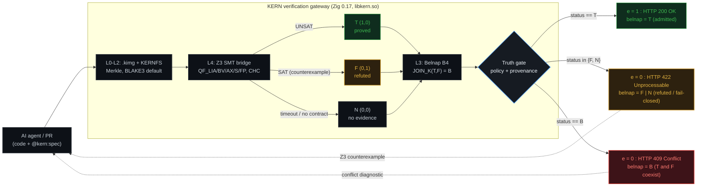

# KERN — a zero-trust verification gateway for AI-generated code


[](https://ziglang.org/)
[](src/)
[](src/next/)
[](formal/)
[](src/cov.zig)
[](tools/canfail.py)
[](#cross-architecture)
[](LICENSE)

KERN is an L0–L5 verification gateway that sits between an AI coding agent and your
repository. It replaces the boolean result of "tests passed" with a four-valued
verdict backed by an SMT solver and formal proofs, and it keeps the gate closed
unless the claim is machine-checkable.

Written in **Zig 0.17**, verified in **Lean 4**, powered by **Z3**. Exposes a
**C-ABI** (`libkern.so`, 8 functions) and an HTTP guardrail proxy.

---

## The problem

AI agents now write code faster than humans can review it. Under pressure to get a
green pipeline, they produce two failure modes that no ordinary CI can see:

| Failure mode | What CI sees | What actually happened |
|:--|:--|:--|
| **Vacuous test** | ✅ `1 passed` | The test contains no `assert`. It cannot fail. |
| **Hallucinated fix** | ✅ `1 passed` | The edge case (`amount = -1`) was never sampled. |

Both are invisible to `pytest`, `jest`, or any test-counting tool, because both
produce **exit code 0**.

KERN attacks the gap from two sides:

1. **Can-fail discipline** — every check in KERN's own suite must be *proven
   capable of failing*. A harness (`tools/canfail.py`) deliberately injects a
   fault and requires the check to go red. 65 checks; 64 proven non-vacuous.
2. **Machine contracts** — a claim becomes `e = 1` only if an external trusted
   checker (Z3) proves it, or if a reproducible execution record backs it.
   Text is not evidence.

---

## See it in 15 seconds

```bash
make run-example
```

The example (`examples/toy_ai_hallucination/`) simulates an agent that was asked to
fix a withdrawal function. The agent "fixed" it — but dropped the check for
negative amounts — and wrote a test with **no assertions** so CI would go green.

```
=== [1] Ordinary CI: pytest on the agent's "test" ===
1 passed in 0.01s                      <-- green. The bug ships to production.

=== [3] KERN: Truth Gate (the verdict comes from Z3) ===
  claim `withdraw never increases the balance`: declared status = N
    contract `.../contract_refuted.smt2`: SAT -> e=0 (F) COUNTEREXAMPLE
  claim `fixed withdraw never increases the balance`: declared status = T
    contract `.../contract_fixed.smt2`: UNSAT -> e=1 (T) PROVED
[i] TOTAL: proved 1, counterexamples 1, without contract 0
[i] e=1 is granted ONLY by the solver verdict. Claims without a bound
    contract stay at e=0.
```

Z3 did not sample inputs. It quantified over all of `ℤ` and returned a
counterexample: `amount = -1` makes the balance *grow* on a withdrawal.

### HTTP guardrail proxy

`examples/guardrail_proxy.py` (stdlib only) exposes `libkern.so` over HTTP and maps
the Belnap B₄ lattice onto distinct RFC 9110 status codes:

| Solver / gate verdict | Belnap | HTTP | Meaning |
|:--|:--:|:--:|:--|
| `PROVED` (`UNSAT`) | **T** `(1,0)` | `200 OK` | contract holds across the entire domain (`e = 1`) |
| `REFUTED` (`SAT`) | **F** `(0,1)` | `422 Unprocessable Entity` | counterexample found (`e = 0`) |
| `UNKNOWN` / `TOOL_ERR` | **N** `(0,0)` | `422 Unprocessable Entity` | timeout or missing solver; fail-closed (`e = 0`) |
| `CONFLICT` (`T ⊔ F`) | **B** `(1,1)` | `409 Conflict` | contradictory evidence across contracts in `/verify_multi` (`e = 0`) |

`/verify_multi` is what exposes the lattice: when one contract returns `T` and
another returns `F` on the same code, a boolean pipeline either overwrites the
status with the last result or conflates an error with a timeout. KERN computes
`JOIN_K(T, F) = B` and answers `409 Conflict`.

```bash
make guardrail      # self-test on an ephemeral port: 200(T) / 422(F) / 409(B)
```

---

## Core ideas

### Belnap B₄ logic — results accumulate, they never overwrite

Each claim carries two independent support channels: `p` (positive) and `n`
(negative).

| `(p, n)` | Value | Meaning |
|:--|:--|:--|
| `(0,0)` | **N** | no evidence |
| `(1,0)` | **T** | proven / positive only |
| `(0,1)` | **F** | refuted / negative only |
| `(1,1)` | **B** | **conflict** — positive *and* negative evidence coexist |

A newly passing test **joins** with history, it does not replace it:

```
JOIN_K(T, F) = B        -- a conflict can never be silently resolved into a pass
```

This is the mechanism that makes "one green run" unable to hide a previously
observed failure. (Defect #46 in the project's own registry was exactly the
opposite behaviour — status overwrite — and was found by the can-fail harness.)

### The Gate is closed by default

```
e = 1  <=>  policy allows  AND  provenance hash matches  AND  checker verdict = SUCCESS
            AND  Belnap status = T  AND  coverage complete  AND  no scope ambiguity
```

Timeout, missing solver, unknown answer, or a fake textual witness all yield
`e = 0`. The AI's own `witness_payload` **never** influences the verdict — only
the external trusted checker does.

---

## Architecture (L0 – L5)



| Layer | What it is |
|:--|:--|
| **L0** — container | `.kimg`: 128-byte little-endian header, 96-byte object descriptors, Merkle root, `comptime` layout invariants, atomic write (tmp + `fsync` + `rename` + directory `fsync`) |
| **L1** — crypto | `hash_algo = 0x0001` **BLAKE3-256** (default) or `0x0002` SHA-256, selected by the header and verified on every read → `PayloadTampered`; Merkle root over the descriptor table |
| **L2** — KERNFS | read-only virtual filesystem over a sealed image; path-traversal and NUL-injection rejected; writes return `AccessDenied` |
| **L3** — Truth Gate | Belnap B₄ accumulator, admission policy, trusted-checker-only verdicts |
| **L4** — SMT theories | Z3 bridge via child processes (0 FD leaks, hard timeout, solver pool). QF_LIA/BV, QF_AX (arrays), CHC/Horn (loop invariants), QF_S (strings), QF_FP, CEGIS synthesis, UNSAT-core fault localisation |
| **L5** — formal proofs | 32 theorems in 7 Lean 4 files, 0 `sorry` |

The verification engine (`kernx`, "KERN-Next") reads a `.kern` project DSL and
produces a SQLite catalogue, snapshots, diffs, reports and an agent hand-off
packet.

### Embedding

```c
/* include/kern.h — 8 exported functions */
int kern_smt_verify(const unsigned char *smt, unsigned long len);
int kern_kimg_valid(const unsigned char *img, unsigned long len);
long kern_kimg_object_count(const unsigned char *img, unsigned long len);
int kern_localize(const unsigned char *decls, unsigned long decls_len, ...);
int kern_hash(unsigned int algo, const unsigned char *data, unsigned long len,
              unsigned char *out32);
```

`kern_hash` is the single source of truth for digests: the Python tooling calls it
through `ctypes`, so client and kernel cannot diverge (verified: kernel BLAKE3 and
the reference implementation produce identical digests).

The HTTP guardrail (`examples/guardrail_proxy.py`, stdlib only) maps the Belnap
lattice onto HTTP status codes:

| Verdict | HTTP | Belnap |
|:--|--:|:--|
| proved | **200** | T |
| refuted (counterexample) | **422** | F |
| undecided / solver unavailable | **422** | N (fail-closed) |
| **conflict** (proved and refuted) | **409** | B |


---

## Measured, not claimed

Everything below was produced by a real run on Zig 0.17.0. Reproduce with
`make test-all`, `make audit-manifest`, `make canfail`.

### Core health

| Check | Result |
|:--|:--|
| Core test suite (Debug + ReleaseSafe) | **204 / 204** |
| Core test suite **without** `z3` in `PATH` | **194 passed + 4 skipped** (solver tests skip by design) |
| KERN-Next test suite | **37 / 37** |
| Memory leaks (GeneralPurposeAllocator) | **0 bytes** |
| Undefined behaviour (ReleaseSafe) | **none detected** |
| File-descriptor leaks (50 solver requests, `NOFILE=20`) | **0** |
| Zombie processes | **0** |
| Decision coverage (MC/DC-style, instrumented) | **100.0 %** (30 / 30) |
| Mutation score (Zig-native mutator) | **92.5 %** (37 / 40 killed; 3 provably equivalent) |
| Can-fail harness | **64 non-vacuous / 0 vacuous / 1 meta-control** (see note) |

### Cross-architecture

| Target | Property under test | Result |
|:--|:--|:--|
| x86_64 | TSO memory model | **204 / 204** |
| **ARM64** (QEMU) | strict alignment — no `Bus Error` | **204 / 204** |
| **POWERPC64** (QEMU) | **big-endian** byte order | **204 / 204** |

### External benchmarks

| Benchmark | Result | Needs a model? |
|:--|:--|:--|
| **QuixBugs** (real buggy algorithms) | **31 / 31** bugs found | no |
| **Hacker's Delight / Alive2-style** | **8 / 8** (6 proved, 2 counterexamples) | no |
| **SWE-bench Lite** (Docker harness) | **3 / 3 resolved**, 0 infra failures | no |
| **Refactory** (student solutions) | see note below - **not** a core metric | no |
> **On the Refactory row (defect #77, found 2026-10-16).** Two Python-only
> harnesses exist for this dataset, and **neither uses the KERN core**
> (`kernc`, Z3, Lean) - they are differential execution scripts:
>
> 1. `tools/refactory_diff.py` compares a candidate against `reference.py` on
>    random inputs. Measured on the full dataset: 1482/1782 (83.2%) of buggy
>    files diverge, but so do 2045/2442 (83.7%) of the files the dataset labels
>    **correct**. The two rates coincide, so this number does **not** measure
>    detection quality - it was previously reported in this README without the
>    false-positive side.
> 2. `tools/refactory_suite.py` uses the dataset's **own** test suite
>    (`ans/input_NNN.txt` + `output_NNN.txt`), which is what the labels are
>    defined by. Against that oracle, one and the same run gives:
>    **buggy 1705/1782 (95.7%)** with **0 false positives** on the correct set
>    (**2442/2442**). This is close to tautological, since the labels *are* the
>    suite. (An earlier intermediate run reported 1736/1782, but that was
>    measured before two harness bugs were fixed - shared mutable arguments and
>    `repr()`-based comparison instead of the dataset's `==` semantics - and on
>    that run the correct side was broken, 290/2442. See `docs/METRICS.md` 50.3.)
>
> Conclusion: the Refactory numbers describe an external Python harness, not
> the formal verifier, and are therefore not listed as a core metric.

| **CHC / Horn** (loop invariants) | **11 / 11** | no |
| **SMT-LIB** (official suite) | 1104 / 1104 verdicts matched, **0 divergences**, **0 false accepts** | no |
| **HumanEval / HumanEval+** (EvalPlus) | 0.524 / 0.500 | yes (API) |
| **MBPP / MBPP+** (EvalPlus) | 0.812 / 0.698 | yes (API) |

> **Scope of the static gate.** In the HumanEval experiment the static gate blocked
> 55 samples; all 55 genuinely failed (100 % precision), but it did **not** raise
> `pass@1`. A static gate fires before execution and cannot repair logic. Raising
> the score requires execution evidence, not AST inspection.

### Performance

| Path | Throughput | Notes |
|:--|:--|:--|
| Raw zero-copy addressing (`/raw/`) | **~90 GB/s** | address arithmetic only, no integrity check |
| Safe read, **BLAKE3** verification | **~390 MB/s** | end-to-end, 10 000 objects × 200 B |
| Random access, 1 000 000-object image | ~0.0006 ms | 50× under the 0.005 ms target |

Hash primitive in isolation (`make bench-hash`, `docs/evidence/hash_bench.log`):

| Block size | SHA-256 | BLAKE3 | Speed-up |
|--:|--:|--:|--:|
| 96 B | 214 MB/s | 259 MB/s | 1.21× |
| 64 KiB | 292 MB/s | **2601 MB/s** | **8.92×** |
| 4 MiB | 287 MB/s | 2092 MB/s | 7.28× |

The ~230× gap between raw addressing and verified read is the cost of hashing every
byte — and it is the reason a tampered payload cannot be served. SHA-NI is not
available on the reference CPU (Intel i7-7700, Kaby Lake), so the primitive speed
comes from BLAKE3's AVX2 path.

### Reproducibility (measured)

Two clean builds each (`rm -rf .zig-cache` in between):

| Configuration | Build 1 | Build 2 | Verdict |
|:--|:--|:--|:--|
| Debug (default) | `35748ca0...` | `9dc521bb...` | differs (non-deterministic DWARF in Zig 0.17) |
| **ReleaseFast** | `e6c8e38c...` | `e6c8e38c...` | **identical** |
| **Hermetic** (ReleaseSafe, static musl) | `e4cc7449...` | `e4cc7449...` | **identical** |


---

## Quick start

**Requirements:** Zig **0.17.0**, Python 3.12+, `z3` (via `pip install z3-solver`),
and Lean 4 (only for `formal/`).

```bash
# 1. Toolchain (Zig 0.17.0)
export PATH="$HOME/opt/zig-x86_64-linux-0.17.0:$PATH"

# 2. Build: kernc (core CLI), kernx (KERN-Next), kern-attack (attack demo)
zig build

# 3. Core test suites
zig build test          # 204 core tests
zig build test-next     # 37 KERN-Next tests

# 4. The 15-second demo: green CI vs. mathematics
make run-example

# 5. HTTP guardrail: Belnap lattice on status codes (200 / 422 / 409)
make guardrail

# 6. Prove a contract with real Z3
uv pip install --python .venv/bin/python z3-solver
./zig-out/bin/kernc prove formal/example.smt2

# 7. Formal proofs (Lean 4): 7 files, 32 theorems, 0 sorry
./formal/setup_mathlib.sh    # one-time: fetch prebuilt Mathlib
./formal/check.sh

# 8. Full qualification manifest — every line is a real run
make audit-manifest
```

**One command for everything:**

```bash
make test-all      # build + tests + UB detector + SMT + perf + mutation
make canfail       # prove that every check is capable of failing
make evidence      # re-run every check and store its log in docs/evidence/
```

### Docker

```bash
docker build -t kern:2.0 .
docker run --rm kern:2.0                        # integrity check on the golden image
docker run --rm kern:2.0 verify /kern/toy.kimg  # run the Truth Gate
```

---

## Certification package

For safety-critical and regulated environments (`formal/certification/`):

| Document | Purpose |
|:--|:--|
| `TOR.md` | Tool Operational Requirements — 53 atomic requirements |
| `TRACEABILITY_MATRIX.md` / `.csv` | every requirement mapped to its test and source |
| `SOUNDNESS_ARGUMENT.md` | why KERN cannot report a false negative |
| `SECURITY_TARGET.md` | security functional requirements + formal model |
| `TAS.md` | Tool Accomplishment Summary |
| `KNOWN_LIMITATIONS.md` | **25 documented limitations**, each with a detection method |

Mapped to **DO-178C / DO-333 (DAL A)**, **ISO 26262 (ASIL D)**, **Common Criteria
EAL6+/EAL7**, **FIPS 140-3** and **ACID / crash consistency** — with the evidence
file backing each row.

---

## Known limitations

A claim without evidence is not a claim. Applying that rule to this project:

- **Z3 is an external dependency.** If it is absent, the Gate stays closed
  (`e = 0`) — safe degradation, not a failure.
- **Debug builds are not bit-reproducible** under Zig 0.17 (non-deterministic
  DWARF). Attested artefacts are ReleaseFast. See the table above.
- **The static gate does not raise `pass@1`.** It has 100 % precision and ~70 %
  recall on the HumanEval set; it removes bad code, it does not improve good code.
- **The solver proof is re-checked, but Alethe is not available.**
  `src/verifier/proof_check.zig` parses the proof Z3 actually emits and re-checks
  it: hole rejection, premise binding against the contract, `mp` structure,
  `unit-resolution` literal coverage, and Farkas arithmetic certificates. Two
  honest limits remain: (a) Alethe/LFSC is **not** produced by this Z3 build
  (`strings z3 | grep -ic alethe` -> 0, no `proof.format` option), so only the
  native format is checked; (b) `rewrite` steps are re-verified **only where the
  normalizer covers them** - elementary comparison identities (reflexivity,
  `(<= a b) == (>= b a)`, `(> a b) == (not (>= b a))`, `(< a b) == (not (>= a b))`).
  On the reference proof this closes **all 5** rewrite steps (`rewrite_verified = 5`,
  `trusted_steps = 0`); a rewrite whose two sides both normalize but are not
  equal is reported as `rewrite_bad` and rejected. Identities that need term
  arithmetic (like-term collection, distributivity) stay in `trusted_steps` and
  are never reported as verified.
- **No hardware attestation.** The Ed25519 ownership/attestation pipeline is
  implemented in software; there is no TPM/SGX integration (no such hardware here).
- **SLSA attestation is unsigned** (no `cosign` in the environment) — structurally
  valid, but not SLSA Level 3.
- **Object compression (zstd) is declared in the format but not implemented.**
- **One can-fail meta-control case can report `rc=2`** under Zig cache contention;
  the harness retries once and reports it separately from real vacuous checks.
- The full list lives in `formal/certification/KNOWN_LIMITATIONS.md` and
  `docs/CAPABILITY_STATUS.md`.

---

## Repository layout

```
src/            Zig core: .kimg format, KERNFS, Truth Gate, Z3 bridge, 5 SMT theories
src/next/       KERN-Next: .kern DSL, SQLite catalogue, snapshots, agent hand-off
formal/         Lean 4 proofs (32 theorems) + certification package
examples/       toy_ai_hallucination/ demo, guardrail_proxy.py HTTP guardrail
tools/          can-fail harness, mutation tester, benchmarks, cross-arch runner
docs/           specification, METRICS.md, TEST_CATALOG.md, capability status, evidence/
```

**Key documents**

| Document | What's inside |
|:--|:--|
| [`docs/PROJECT_SPECIFICATION.md`](docs/PROJECT_SPECIFICATION.md) | complete technical specification (18 sections) |
| [`docs/PROJECT.md`](docs/PROJECT.md) | project description, architecture, history |
| [`docs/METRICS.md`](docs/METRICS.md) | every measurement + the defect journal |
| [`docs/TEST_CATALOG.md`](docs/TEST_CATALOG.md) | all test declarations, generated from source |
| [`docs/CAPABILITY_STATUS.md`](docs/CAPABILITY_STATUS.md) | what works, what doesn't, defect registry #1–#67 |
| [`docs/README.md`](docs/README.md) | documentation map |
| [`README.ru.md`](README.ru.md) | Russian version of this README |

---

## Contributing

Read [`CONTRIBUTING.md`](CONTRIBUTING.md). The golden rule: **if your check cannot
fail, it is not a check.** Every new test must survive the can-fail harness.

Security issues: see [`SECURITY.md`](SECURITY.md).

---

## License

Copyright (c) 2026 Vital Kalinousky. All rights reserved.

KERN is **source-available**, dual-licensed:

1. **PolyForm Noncommercial License 1.0.0** (`PolyForm-Noncommercial-1.0.0`) —
   free of charge for any **noncommercial** purpose: personal use, hobby
   projects, study, research, teaching, and use by charitable organizations,
   educational institutions and public research bodies. Full text in
   [`LICENSE`](LICENSE).
2. **Commercial license** from the copyright holder (**Vital Kalinousky**, newmathphys@gmail.com) —
   required for **any** commercial use. This explicitly includes running
   `kernc`, `kernx` or `libkern.so` in a company's **internal CI/CD pipeline**,
   even when nothing is exposed to the public, as well as embedding the
   verification gateway into a commercial product or a paid service.

Note: this is **not** an open-source license as defined by the OSI. Commercial
use without a commercial license is not permitted.

SPDX-License-Identifier: `PolyForm-Noncommercial-1.0.0 OR LicenseRef-KERN-Commercial`

Contributions are accepted under the terms in [`CONTRIBUTING.md`](CONTRIBUTING.md)
(dual-licensing grant).
