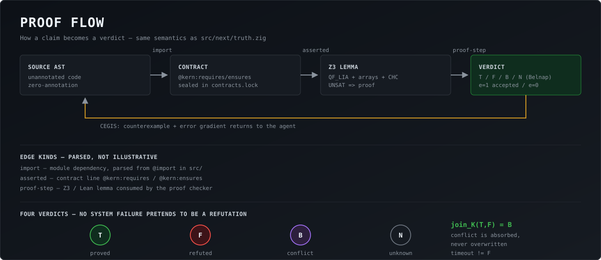

# KERN — ядро проверки истины для ИИ-агентов

> **Facts (EN/RU, synced by `make sync`):** core <!-- fact:core_tests -->449 · next <!-- fact:next_tests -->53 · catalog <!-- fact:catalog -->478 · CHECK <!-- fact:check_targets -->172 · cases <!-- fact:canfail_cases -->210 · anchors <!-- fact:anchors -->171 · registry <!-- fact:registry_targets -->223 · META <!-- fact:meta_targets -->37 · Lean <!-- fact:lean_theorems -->147 · QuixBugs <!-- fact:quixbugs.smt -->6/40 SMT + <!-- fact:quixbugs.differential -->40/40 diff.
> **Живой путеводитель по всем 10 возможностям — RU / EN (генерируется `make demo-all`):** [docs/ALL_CAPABILITIES_LIVE_GUIDE.ru.md](docs/ALL_CAPABILITIES_LIVE_GUIDE.ru.md) · [docs/ALL_CAPABILITIES_LIVE_GUIDE.md](docs/ALL_CAPABILITIES_LIVE_GUIDE.md)
>
> **Снимок текущего состояния (генерируется, гейт `make status-check`):** [docs/STATUS.ru.md](docs/STATUS.ru.md) · [docs/STATUS.md](docs/STATUS.md)
>
> **KERN, применённый к KERN (самопроверка, дословный вывод):** [docs/SELF_VERIFICATION.ru.md](docs/SELF_VERIFICATION.ru.md) · [docs/SELF_VERIFICATION.md](docs/SELF_VERIFICATION.md)
>
> **Устав KERN — каждый закон называет проверяющего, и он запускается:** [docs/CHARTER.ru.md](docs/CHARTER.ru.md) · [docs/CHARTER.md](docs/CHARTER.md)

[](LICENSE)




**Арбитражный шлюз истины для ИИ-агентов.** Заявление получает статус
«доказано» **только при машинной опоре**: вердикт SMT-решателя (Z3), формальное
доказательство (Lean 4) или подтверждённый прогон с кодом возврата.
Всё остальное — честный отказ `e=0`.

**Технологии:** Zig (ядро, zero-copy) · Lean 4 (формальные доказательства) ·
Z3 (SMT) · SQLite (каталог KERN-Next) · C-ABI (`libkern.so`).

> ⚠️ **ВЕТКА И ТУЛЧЕЙН — ЧИТАЙТЕ ПЕРВЫМ.**
> Этот README открыт на ветке **`zig-0.17-migration`** → нужен **Zig 0.17.0**
> (`~/opt/zig-x86_64-linux-0.17.0/zig`).
> **Zig 0.13 на этой ветке НЕ СОБИРАЕТСЯ**: `src/compat.zig` использует `std.Io`,
> которого в 0.13 нет (ошибка `no module named 'compat'` / `no field 'Io'`).
> Ветка **`main`** заморожена на **Zig 0.13.0** и аттестована отдельно —
> карта миграции: [`docs/MIGRATION_REPORT_0_17.md`](docs/MIGRATION_REPORT_0_17.md).

| Показатель | Значение |
|:--|:--|
| Тесты ядра | **<!-- fact:core_tests -->449** (Debug + ReleaseSafe) |
| Тесты KERN-Next | **53** |
| Формальные доказательства | **8 файлов Lean 4** (147 теорем), 0 errors, 0 `sorry` |
| Покрытие инструментированных решений | **100.0%** (30/30) |
| Мутационный score | **100.0%** — полный обстрел **21 файла / 1427 сайтов** (1427/1427 убито, 0 выживших, 23 мин; лог прогона **закоммичен**: `docs/evidence/mutate_full.log` (1 408 строк, `RC=0`), рядом лежат канонический 40/40 и модульные `--full-file` 244/244). Канонический гейт (`make mutate`, seed=7): 40/40 — те же вердикты. Раньше мутатор видел только **6 файлов / 63 сайта** (там 97.5%), поэтому промежуточные 77.5% — это **более широкий и честный** замер, а не регрессия. В этой ревизии: `KERN_MUTATE_FAST` (меньше итераций стресс-циклов, **ни один тест не отключён**: 11.4 с -> 5.8 с на мутанта), `--jobs 4` (2.15x) и `--require-solver` (раньше скор снимался при **8 молча пропущенных тестах** — `z3` не был в `PATH`)  — **Канонический стратифицированный гейт** (`make mutate`, 18 файлов, пул 1152 сайта, seed=7): `40 / 40 (100.0%)`. **Полный обстрел без сэмплирования** (`--full-file`, 184 / 184 = 100.0%): `model_extract` 75/75, `builtin_lia` 17/17, `truth` 26/26, `catalog` 25/25, `wasm_api` 5/5, `capi` 12/12, `blake3_simd8` 6/6, `kimg_reader` 13/13, `kimg_writer` 5/5. |
| Кросс-архитектура | ARM64 и POWERPC64 (big-endian): **<!-- fact:cross_arch_passed -->441 passed / <!-- fact:cross_arch_skipped -->8 skipped / 0 failed** (лог QEMU 2026-10-19, `docs/evidence/cross_arch.log`) — прогон на актуальном наборе |
| C-ABI на чистом C11 (`-Werror -pedantic`) | **20 / 20** — NULL и нулевые длины отвергаются без краха |
| 8-поточный стресс `libkern.so` (`pthread`) | **0 гонок** (8x500 хэшей, 8x20 вызовов Z3) |
| Инъекция OOM (`checkAllAllocationFailures`) | **0 байт утечек** на всех путях отказа |
| Защита парсера от вложенности | **`MAX_SEXP_DEPTH = 4096`** — 2 000 000 скобок дают ошибку, не крах |
| Can-fail харнесс | **<!-- fact:check_targets -->172 / <!-- fact:check_targets -->172 CHECK-целей** покрыты (<!-- fact:canfail_cases -->210 не-вакуумных кейсов, 0 вакуумных) |
| SWE-bench Lite (Docker) | **3/3 resolved**, 0 infra-failures |
| QuixBugs (40 задач, две ступени) | **6/40** формальный SMT (Ступень 1, `trusted: 0`) · **40/40** живой дифференциальный детектор (29 расхождений значения + 10 падений + 1 незавершение; 11 не требуют эталона, 29 сверяются с эталоном датасета) · **0** EXPLORED |
| Фаззинг | **1 000 000** мутаций, 0 паник |
| **ПОЛНОЕ ТЕХНИЧЕСКОЕ ОПИСАНИЕ (18 разделов)** | **[`docs/PROJECT_SPECIFICATION.md`](docs/PROJECT_SPECIFICATION.md)** — математика, архитектура L0–L5, формат байт-в-байт, Врата, SMT, CLI, аттестация, дефекты, ограничения |
| **Полный каталог тестов** | **[`docs/TEST_CATALOG.md`](docs/TEST_CATALOG.md)** |
| **Возможности с доказательствами** | **[`docs/CAPABILITIES.md`](docs/CAPABILITIES.md)** — 11 пунктов: ✅ / ⚠️ / ❌ |
| **Аттестационный паспорт** | **[`docs/ATTESTATION_PASSPORT.md`](docs/ATTESTATION_PASSPORT.md)** — все показатели + сводка поправок |

> **Официальные тест-кейсы QuixBugs — это НЕ метрика KERN (дефект #231).**
> `tools/quixbugs_full.py` прогоняет каждую багованную программу на **её же**
> официальных кейсах: 31/31 падают, 24/31 корректных проходят
> (`docs/evidence/quixbugs_full.log`). Это проверяет **обвязку датасета**, а не
> KERN: «багованная программа падает на своих тестах» — это определение
> датасета, а не результат детекции. Раньше это стояло в таблице как `31/31`
> и читалось как достижение KERN — строка убрана. Собственный результат KERN на
> QuixBugs — строка выше (`40/40`, каждое попадание подтверждено
> живым вызовом функции).
>
> **Как читать строку QuixBugs (дефект #239, обновлено в #276).** `40/40` — это
> **дифференциальное исполнение**, а не формальное доказательство: 29 задач
> вернули значение, отличное от `correct_python_programs/`, 10 упали внутри
> тестируемой функции, 1 не завершилась (`bitcount`). **11 из 40 не требуют
> эталона вообще; 24 — требуют.** Формальный SMT — это отдельные **`6/40`**
> (только Ступень 1, `--stage1-only`, `docs/evidence/quixbugs_stage1.log`).
> 7 `EXPLORED` — «контрпример не найден в конечном домене», а не «доказано
> корректно».

> **Самостоятельный проект.** Не зависит от внешних платформ: ядро, контракты,
> пруф-чекер и контейнеры живут в этом репозитории.

**Статус:** рабочий прототип с измеренными свойствами. Эпистемическая часть
(Врата Истины) исправлена в v1.3 — обход «одним байтом» закрыт, вердикт приходит
только от внешнего чекера (см. `docs/KERN_FIXES_v1_3.md`).

---

## Что говорит агент — и что доказывает KERN

`make ai-demo` проигрывает одну реалистичную сессию ИИ-агента целиком. Фикстуры —
в `examples/ai_vs_kern/`; каждая строка ниже — дословный вывод инструментов.

| Отчёт агента | Что KERN находит в том же коде |
|:--|:--|
| `2 passed in 0.01s` | `[CHEAT DETECTED: swallowed assert (except: pass)]` строка 28 → `R=-2.0` |
| «списания не могут увеличить баланс» | `[FAIL] transfer_with_fee: КОНТРАКТ НАРУШЕН` · `[КОНТРПРИМЕР] result = -1, amount = 1, balance = 0` · `[RUNTIME CONFIRMED]` |
| «комиссия справедлива» | `[FAIL] fee_threshold: no_arbitrage REFUTED` · `[КОНТРПРИМЕР] a1 = 100, a2 = 1` |
| «то же поведение, просто чище» | `[DIVERGED] charge` · `[КОНТРПРИМЕР] res_old = -1, balance = -1, amount = 0, res_new = 0` |
| «безопасный вспомогательный инструмент» | `[MCP] PROMPT INJECTION in "sum": «ignore previous»` · `INVISIBLE UNICODE U+200B` |
| «transfer_funds(900)» | `[FAIL] Firewall: POLICY CONFLICT -> B (1,1), e=0, HTTP 409 Conflict` |

После исправления KERN не верит никому на слово — он перепроверяет доказательство на Zig:

```text
[PASS] transfer_with_fee: ДОКАЗАНО
       [PROOF VERIFIED] steps: 50 | premises bound: 3/3 | mp: 17 |
                        rewrite (linear): 18 | farkas: 2 | trusted: 0 | holes: 0
[REWARD] R=+1.0 [VERIFIED REWARD, Belnap T, e=1]
```

`make ai-demo` падает (`rc=1`), если хоть одна из этих строк исчезнет: демонстрация
не может «уехать» в заявление, которое инструменты больше не подтверждают.

---

## 0. Быстрый старт (5 минут)

```bash
# 0. Сквозная демонстрация «KERN против ИИ» (проверено, 20 ожиданий, 0 сбоев)
make ai-demo
# 0. Попробовать без тулчейна (проверено 2026-10-17, образ 364 МБ)
docker build -t kern:2.4.0 .                        # контекст ~4.3 МБ (.dockerignore)
docker run --rm kern:2.4.0                          # целостность: заголовок + Merkle-корень
docker run --rm kern:2.4.0 verify /kern/toy.kimg    # Врата Истины: SAT -> e=0 (F), UNSAT -> e=1 (T)

# 1. Окружение: Zig 0.17.0 (ветка zig-0.17-migration)
export PATH="$HOME/opt/zig-x86_64-linux-0.17.0:$PATH"
#    (ветка main: make venv && export PATH="$PWD/.venv/bin:$PATH" — там Zig 0.13)

# 2. Сборка: kernc (ядро), kernx (KERN-Next), kern-attack (демонстрация)
zig build

# 3. Тесты ядра — <!-- fact:core_tests -->449 штуки
zig build test

# 4. Эталонный образ и его проверка
make golden
./zig-out/bin/kernc check-integrity tests/fixtures/valid_v1_3.kimg

# 5. Сквозная демонстрация (сборка образа, чтение, Врата, KERN-Next)
make demo
```

**Увидеть вердикт `e=1` (ДОКАЗАНО)** — нужен Z3:
```bash
uv pip install --python .venv/bin/python z3-solver
./zig-out/bin/kernc prove formal/example.smt2     # e=1 — доказано решателем
make bridge                                        # мост «текст → контракт»
```

**Список всех целей:** `make help`

**Аттестационный статус одной командой** (все строки — реальные прогоны):
```bash
make audit-manifest
```
```
[KERN QUALIFICATION AUDIT SUITE v1.3.1]
Core (Debug)          : PASS — <!-- fact:core_tests -->449 / <!-- fact:core_tests -->449 tests
Memory Safety         : PASS — ReleaseSafe, 0 UB
Kernel Invariants     : PASS — Lean 4 (8 files, 147 theorems, 0 errors, 0 sorry)
Target Systems        : PASS — ARM64 POWERPC64
Attack Surface        : PASS — 2/2 (0xAA-обход закрыт, KERNFS согласован)
Decision Coverage     : PASS — 100.0% (порог 95%)
Mutation Coverage     : PASS — 100.0% (охват 21 файла / 1427 сайтов)
Formal Theories       : PASS — 5/5 (UNSAT-core, QF_AX, CHC, QF_S, CEGIS)
Payload Integrity     : PASS — Merkle + SHA-256 (PayloadTampered)
```

**Детерминированный симулятор** (VOPR-стиль, как TigerBeetle):
```bash
make sim    # 80 000 операций, 4 сида, инварианты I1–I4
```
Тот же сид даёт ту же историю на любой машине; при падении сид воспроизводит
его с точностью до операции.

---

**Сайт:** <https://newmathphys.github.io/kern/> — лендинг с быстрым стартом,
измеренными числами и шагом «проверь то, что скачал».

**K.E.R.N.** — *Knowledge Evaluation and Resolution Node* (Узел оценки и резолюции знаний):
**K**nowledge — всё, что генерирует ИИ-агент (код, контракты, тесты); **E**valuation —
математическая проверка этих заявок (Z3 SMT + независимый пруф-чекер на Zig + теоремы
Lean 4); **R**esolution — разрешение конфликтов в четырёхзначной логике Белнапа
(`T ⊔ F = B`, противоречие не перезаписывается); **N**ode — единый шлюз L0–L5:
`e = 1` проходит в продакшен, `e = 0` блокируется.

## 1. Состав

```
kern/
├── README.md                       этот файл
├── LICENSE                         PolyForm Noncommercial 1.0.0
├── OWNERSHIP.md                    защита авторства (токен, ключ-замок)
├── Makefile                        190 целей: build/test/coverage/mutate/bridge/…
├── build.zig                       сборка: kernc, kern-attack, kernx, libkern.so
│
├── docs/                           ДОКУМЕНТАЦИЯ (начните с docs/README.md)
│   ├── README.md                   КАРТА документации — что где лежит
│   ├── TEST_CATALOG.md             ПОЛНЫЙ каталог 425 тестов + бенчмарки
│   ├── METRICS.md                  ЖУРНАЛ ПОКАЗАТЕЛЕЙ (все цифры из прогонов)
│   ├── KERN_FIXES_v1_3.md          16 устранённых дефектов, с доказательствами
│   ├── VERIFICATION_GOLD_STANDARDS.md  мировые бенчмарки
│   ├── EXECUTION_RUNNER.md         переход N→T через машинные свидетельства
│   ├── SPEC_ANCHORS_DEMO.md        мост «текст → контракт» (@kern:spec)
│   ├── KERN_TERMINOLOGY_v0.1.md    нормативная терминология
│   ├── evidence/                   свидетельства прогонов (JSON/JSONL)
│   └── archive/                    исторические аудиты (KERN*_AUDIT.md)
│
├── formal/                         ФОРМАЛЬНЫЕ ДОКАЗАТЕЛЬСТВА
│   ├── check.sh                    компиляция всех теорем + проверка на 'sorry'
│   ├── KernAllMath.lean            Белнап, де Морган, JOIN_K, анти-вакуум
│   ├── KernDfsTermination.lean     завершаемость, граница топлива
│   ├── KernTalk.lean / KernTalkND.lean   унификация требований
│   ├── KernConvergence.lean        сходимость итерации
│   ├── KernZeroCopy.lean           изоморфизм zero-copy
│   ├── KernSemanticGap.lean        разрыв ℤ ↔ i32
│   ├── gate_mask.smt2              контракт для моста (пример)
│   └── certification/              TQD: трассируемость, soundness, security target
│
├── src/                            ИСХОДНИКИ
├── tools/                          утилиты: сканер, бенчмарки, мутатор, раннер
├── tests/                          фикстуры и внешние сьюты
├── examples/                       примеры .kern, toy-пример, C-ABI демо
└── docs/                          спецификация, метрики, статус возможностей
```

**Карта документации:** [`docs/README.md`](docs/README.md)
**Полный каталог тестов:** [`docs/TEST_CATALOG.md`](docs/TEST_CATALOG.md)

---

## 2. Зачем это

KERN — «таможня истины» между ИИ-агентом и реальным кодом. Идея:

1. ИИ генерирует код и **утверждение** («функция безопасна», «тесты прошли»).
2. Утверждение допускается только при **машинной опоре** (прогон, доказательство).
3. Следующему агенту передаётся **компактный пакет**: что доказано, что
   проверять, что открыть, что нельзя трогать.

Математическая основа — **решётка Белнапа-Данна B4**: факт имеет два независимых
бита (подтверждение `p` и опровержение `n`).

| код | статус | смысл |
|:--:|:--|:--|
| 0 | **N** | ничего не известно (гипотеза ИИ) |
| 1 | **T** | доказано |
| 2 | **F** | опровергнуто (найден контрпример) |
| 3 | **B** | конфликт: тесты зелёные, но прувер нашёл баг |

---

### 1.1 Подробнее: `src/` и `tools/`

```
├── main.zig                        CLI kernc (читает образ .kimg)
├── attack.zig                      демонстрация: обе атаки закрыты
├── test_root.zig                   корень тестов ядра (<!-- fact:core_tests -->449 теста)
├── core/
│   ├── eq2.zig                     KERN-EQ2: Белнап, joinK/meetK, andT/orT/notB
│   ├── object_entry.zig            96-байтный дескриптор + Merkle-корень
│   ├── kimg_reader.zig             128-байтный заголовок + безопасная арифметика
│   ├── kimg_writer.zig             сборка .kimg (атомарная запись + fsync)
│   ├── kernfs_router.zig           VFS: валидация путей, монтирование, AccessDenied
│   ├── mmap_guard.zig              перехват SIGBUS (обрыв mmap)
│   └── sigbus_guard.zig            обработчик сигнала
├── verifier/
│   ├── admission_gate.zig          Врата Истины: вердикт ТОЛЬКО от внешнего чекера
│   ├── z3_bridge.zig               Z3 SMT-LIB2 мост (таймаут, graceful)
│   ├── unsat_core.zig              локализация ошибки (get-unsat-core)
│   ├── array_theory.zig            QF_AX: аксиомы Маккарти, алиасинг
│   ├── chc.zig                     CHC/Horn: инварианты циклов (SPACER)
│   ├── string_theory.zig           QF_S: инъекции, path traversal
│   ├── cegis.zig                   CEGIS/SyGuS: синтез кода
│   ├── proof_check.zig             независимая проверка шагов Z3
│   ├── dtmc.zig                    вероятностный анализ (PCTL)
│   ├── abstract_interp.zig         абстрактная интерпретация (интервалы)
│   ├── noninterference.zig         невмешательство (HyperLTL)
│   ├── nra_quant.zig               нелинейная арифметика + кванторы
│   └── redos.zig                   ReDoS-анализ регулярных выражений
├── runtime/kern_x.zig              KERN-X: fuel-bounded VM (без зависаний)
├── next/                           KERN-Next (движок `kernx`, 53 теста)
│   ├── ast.zig · parser.zig        модель + парсер языка .kern
│   ├── validate.zig                валидатор (10 правил)
│   ├── catalog.zig                 SQLite-каталог .kdb
│   ├── snapshot.zig · cache.zig    снапшоты/diff + инкрементальность
│   ├── export.zig · engine.zig     agent packet, отчёт, конвейер
│   ├── truth.zig                   Белнап-аккумулятор (N→T/F/B)
│   └── main.zig                    CLI kernx
├── proof_cache.zig                 кэш доказательств (потокобезопасный)
├── attest.zig · owner.zig          аттестация Ed25519 + токен авторства
├── atomic_write.zig                атомарная запись (tmp+fsync+rename)
├── capi.zig                        C-ABI (libkern.so, 7 функций)
├── concolic.zig                    конколическое исполнение
├── fuzz_ast.zig                    1 000 000 мутаций, 0 паник
├── smt_stress.zig · kimg_stress.zig  стресс Z3 и .kimg (1 млн объектов)
├── perf_bench.zig · smt_bench.zig · chc_bench.zig · stress_real.zig  бенчмарки
└── tests/
    ├── exhaustive_suite.zig        security-сьют (SEC/MATH/AI/RES)
    ├── alignment_stress.zig        Эшелон 1: выравнивание + endianness
    ├── pool_saturation.zig         Эшелон 3: изнурение пула потоков
    ├── mcdc_gates_test.zig         MC/DC-векторы решений Врат
    ├── litmus_memory_test.zig      слабые модели памяти
    ├── oom_stress.zig · z3_crash_test.zig · smt_incremental_test.zig
    ├── fault_injection_test.zig    сбои памяти (SIGBUS)
    └── coverage_report_test.zig    покрытие инструментированных решений

├── tools/
│   ├── scan_to_kern.py             сканер проекта → .kern (+ якоря @kern:spec)
│   ├── golden_v1_3.py              эталонный образ .kimg v1.3
│   ├── kern_exec_runner.py         Execution Runner (N→T через прогон)
│   ├── mutate_zig.py               мутационное тестирование (работает на копии)
│   ├── quixbugs_full.py            QuixBugs: обвязка датасета (НЕ метрика KERN — дефект #231)
│   ├── refactory_diff.py           Refactory (дифференциальный)
│   ├── solver_crosscheck.py        Z3 ↔ cvc5
│   ├── cache_avalanche_bench.py    лавина хэша (100 000 мутаций)
│   ├── humaneval_api.py            HumanEval/HumanEval+ через API
│   ├── binlevel_verify.py/.sh      бинарный уровень (translation validation)
│   ├── cross_arch_test.sh          ARM64 + POWERPC64 под QEMU
│   └── push_to_github.sh           выгрузка закрытого репозитория
```

---

## 3. Запуск

```bash
# 1. Компилятор Zig 0.17.0 (ветка zig-0.17-migration; 0.13 здесь НЕ подходит)
export PATH="$HOME/opt/zig-x86_64-linux-0.17.0:$PATH"
zig version   # должно быть 0.17.0
#
# Для ветки `main` (замороженный baseline) — наоборот, Zig 0.13:
#   uv venv .venv && uv pip install --python .venv/bin/python ziglang==0.13.0
#   export PATH="$PWD/.venv/bin:$PATH"

# 2. Эталонный образ
python3 tools/golden_v1_3.py

# 3. Сборка (kernc, kern-attack, kernx)
zig build

# 4. Тесты: ядро (400) и KERN-Next (53)
zig build test
zig build test-next        # требует libsqlite3

# 5. Демонстрация: обе атаки закрыты
./zig-out/bin/kern-attack

# 6. CLI kernc
./zig-out/bin/kernc check-integrity tests/fixtures/valid_v1_3.kimg
./zig-out/bin/kernc ls  tests/fixtures/valid_v1_3.kimg
./zig-out/bin/kernc cat tests/fixtures/valid_v1_3.kimg /raw/src/main.zig
./zig-out/bin/kernc verify tests/fixtures/valid_v1_3.kimg

# 6a. РЕАЛЬНОЕ доказательство через Z3 (e=1) — нужен z3 в PATH
uv pip install z3-solver                      # даёт бинарник .venv/bin/z3
export PATH="$PWD/.venv/bin:$PATH"
./zig-out/bin/kernc prove formal/example.smt2 # e=1 ДОКАЗАНО / e=0 (контрпример)
./zig-out/bin/kernc audit                    # 5 теорий: UNSAT-core, массивы, CHC, строки, CEGIS
make theories                                # те же 5 теорий тестами
make echelons                                # 4 эшелона: выравнивание, лавина, пул, семант. разрыв

# 6b. Финальная спецификация: сборка, унификация, KERN-X, handoff
./zig-out/bin/kernc build examples/project.kern -o release.kimg
./zig-out/bin/kernc unify 50 120            # RLAIF: конфликт + градиент ошибки
./zig-out/bin/kernc run release.kimg --fuel 100   # KERN-X (если есть байткод)
./zig-out/bin/kernc handoff release.kimg    # agent_packet.json из образа

# 7. KERN-Next
./zig-out/bin/kernx build examples/project.kern --out .kernnext --scope issue-42
./zig-out/bin/kernx status examples/project.kern
./zig-out/bin/kernx report examples/project.kern
./zig-out/bin/kernx packet examples/project.kern --scope issue-42
./zig-out/bin/kernx diff <snapA> <snapB>

# 8. Формальные доказательства Lean 4 (0 ошибок, 0 sorry)
./formal/check.sh
```

---


## Живые ИИ-модели, измеренные KERN (а не на словах)

Контракт — это спецификация (её пишем мы), модель пишет только тело. Раунд 1 —
вслепую; на опровергнутый ответ модель получает точный контрпример Z3 и подсказку
`explain --hypotheses`, затем одну попытку починки.

| Задача | Язык | deepseek | glm | mimo | minimax | nemotron |
|---|---|---|---|---|---|---|
| целочисленное среднее с потолком 500 | Python | T | T | T | нет файла | T |
| сумма `i32`, `ensures result >= a` | **Zig** | **F → F** | **F → F** | **F → F** | **F → F** | **F → (таймаут)** |
| целочисленное деление без защиты | **C** | F → **T** | F → **T** | N (цикл, вне подмножества) | нет файла | не измерено |
| сумма `i32`, `ensures result >= a` | **Rust** | F → **T** | F → **T** | T | **F → F** | не измерено |
**Эквивалентность рефакторинга (без контрактов, `--diff-equiv` + `QueryKind.equivalence`):** те же пять
моделей просили «оптимизировать» `clamp_int` из `boltons`:

| Модель | Вердикт `--diff-equiv` |
|---|---|
| deepseek | **DIVERGED** — `x = 0, lo = 0, hi = -1`: было `0`, стало `-1` |
| glm | **EQUIVALENT** (добавила явную проверку `if lo > hi: return lo`) |
| mimo | **DIVERGED** — та же переписка, тот же контрпример |
| nemotron | **DIVERGED** |
| minimax | файл не создан |

Честная тонкость: `max(lo, min(x, hi))`, переписанный двумя `if`, эквивалентен **только при `lo <= hi`**
(предусловие контракта). `--diff-equiv` сравнивает БЕЗ контракта, поэтому показывает расхождение в области
`lo > hi` и печатает свидетельство. Это строгость инструмента, а не глупость модели.

Пять моделей, 20 ячеек (4 задачи × 5 моделей): **5 доказано, 10 опровергнуто, 1 честное `N`,
2 «файл не создан», 2 не измерено** (прогон остановлен по таймауту модели). После контрпримера KERN
**4 из 10 исправлено** — при этом Zig-задачу на переполнение не исправила **ни одна** модель, а
Rust-двойник той же задачи исправили три.

### Анти-самообман: живые компиляторы подтверждают каждый вердикт

`make anti-self-deception-check` (постоянный гейт) прогоняет контрпримеры KERN через настоящие
инструменты и мутирует каждый доказанный файл:

| Случай | Язык | Свидетельство KERN | Живой инструмент | Результат |
|---|---|---|---|---|
| `py_abs_bad.py` | Python | `x = -1, result = -1` | `python3` + контракт как `assert` | **AssertionError (rc=1)** |
| `c_unguarded.c` | C | `b = 0` | `gcc -fsanitize=undefined` | **runtime error: division by zero** |
| `rust_overflow.rs` | Rust | `a = 2147483647, b = 1` | `rustc -C overflow-checks=on` | **panic: attempt to add with overflow** |
| `zig_div.zig` | Zig | `b = 0` | `zig run` | **panic: division by zero (SIGABRT)** |
| модель `add32` | Zig | `a = 2147483647, b = 1` | `zig run` | **panic: integer overflow (SIGABRT)** |

**Наземная проверка 5/5** — ни одного «бумажного» свидетельства. **Убийство мутаций 5/5** — каждый
доказанный файл переходит `T → F` при поломке тела, каждый с контрпримером. Одна мутация выживает
НАМЕРЕННО: `if x < lo → if x <= lo` — **эквивалентный** мутант (при `x == lo` обе ветки возвращают `lo`),
и доказатель, ответивший там `F`, был бы неправ: это понимание математики, а не сравнение текста.


Раунд 1 вслепую: **4 доказано, 7 опровергнуто, 1 честное `N`** · после контрпримера
KERN **4 из 7 исправлено**. Три оставшихся — это **одна и та же** Zig-задача на
переполнение: все модели повторно прислали `return a + b;`, хотя в промпте было
свидетельство `a = 2147483647, b = 1 -> 2147483648`; Rust-двойник той же задачи они
починили (`a.saturating_add(b)`).

А когда контракт **невыполним**, модели переписывают спецификацию вместо честного
ответа: обе протестированные сузили `@kern:requires` (не тронув `@kern:ensures`) —
замок ловит именно это (`contracts-lock-check`, rc=2).

Сырые артефакты: [`docs/evidence/leaderboard/`](docs/evidence/leaderboard/),
[`docs/evidence/live_eval/`](docs/evidence/live_eval/); подробности в
[`docs/LIVE_MODEL_EVAL.md`](docs/LIVE_MODEL_EVAL.md).
## 4. Что **работает** (измерено)

| Свойство | Как проверено |
|:--|:--|
| **Zero-copy чтение через mmap** | срез памяти, копирования нет |
| **CONF-13: path traversal** | все отказы: нет `/`, `//`, `.`, `..`, NUL |
| **CONF-15: reserved-байты** | порча байта 95 → `InvalidReservedBytes` |
| **Безопасная арифметика** | offset bomb → `OutOfBoundsOffset` в Debug И ReleaseFast |
| **Алгебра Белнапа** | таблицы join/meet, законы де Моргана полным перебором |
| **Merkle-корень** | пересчёт совпадает; подмена байта → `MerkleRootMismatch` |
| **Врата Истины** | `e=1` только по вердикту внешнего чекера; 0xAA → `e=0` |
| **KERNFS находит объекты** | `/raw/...`, `/claims/.../status`, `/claims/.../contract.json` |
| **Запись запрещена** | `write()` → `AccessDenied` (CONF-06) |
| **CLI читает образ** | `check-integrity`, `ls`, `cat`, `verify`, `report` |
| **KERN-Next конвейер** | `.kern` → SQLite-каталог → snapshot → packet/report → diff |
| **Инкрементальность** | неизменённый `.kern` → обработка пропускается |
| **Сборка .kern → .kimg** | `kernc build` → образ v1.3, читается KERNFS |
| **RLAIF-унификация** | `kernc unify 50 120` → конфликт `B` + градиент ошибки 70 |
| **KERN-X (топливо)** | `kernc run` → `HALT OK` или `OutOfFuel` (зависание невозможно) |
| **Z3-мост** | `uv pip install z3-solver` → **реальный прувер**: `kernc prove` → `e=1` (доказано) / `e=0` (контрпример) |
| **SMT-стресс** | 18/18: парадокс `x>5∧x<2`→vacuous, overflow i32→контрпример, NIA `x*x≥0`→proved, Alive2-пары |
| **Кросс-проверка решателей** | Z3 ↔ cvc5: **9/9 согласие, 0 расхождений** |
| **Целостность payload** | подмена байта содержимого → `PayloadTampered` |
| **Ресурсы ОС** | 0 утечек FD, 0 зомби-процессов, «пчелиный рой» 64 потока → 1 miss + 63 hits |
| **Crash-consistency** | атомарная запись (temp + rename) — нет битых образов |
| **Эшелон 1: выравнивание** | 8/8: невыровненный разбор (смещения 1,2,3,5,7) безопасен на ARM64/RISC-V |
| **Эшелон 2: лавина хэша** | SHA-256: лавина **50.0%**, 0 коллизий, макс. цепочка **7** (наивный: 3.1%, цепочка 100000) |
| **Эшелон 3: пул потоков** | 128 запросов на 4–8 воркеров: лимит соблюдён, голодания нет |
| **Эшелон 4: семант. разрыв** | `KernSemanticGap.lean`: **8 теорем** — разрыв ℤ vs i32 доказан формально |
| **UNSAT Core (локализация)** | `(get-unsat-core)` → точные имена конфликтующих строк (`line_10`, `goal`) |
| **Теория массивов (QF_AX)** | аксиомы Маккарти: `select(store(a,i,v),i)=v` и независимость ячеек — **ДОКАЗАНО** |
| **CHC / Horn (инварианты циклов)** | `set-logic HORN` (SPACER): `while(x<10) x++` ⇒ `x≥10` — **ДОКАЗАНО** |
| **Строки (QF_S)** | санитайзер `/` без `..` → **УЯЗВИМОСТЬ**; нуль-байт достижим |
| **CEGIS (синтез кода)** | по спецификации `x*8` **синтезировано `x<<3`** (доказано на 2³² входах) |
| **Перехват SIGBUS (реальный)** | `siglongjmp`: чтение PROT_NONE и обрезанный mmap-файл — **3/3**, процесс жив |
| **Аттестация `.kimg`** | `kernc attest sign/verify`: Ed25519-сертификат 136 Б; подмена образа/сертификата → **отвергнуто** |
| **Покрытие решений** | `make coverage`: **100.0%** (30/30 инструментированных решений, порог 95%) |
| **MC/DC (DO-178C)** | `mcdc_gates_test.zig`: каждое условие Врат влияет независимо |
| **Инкрементальный SMT** | `push/pop`: 30 запросов **527 мс → 26 мс (20×)**; 0 ложных `proved` |
| **Крах решателя** | SIGPIPE/мёртвый пайп → KERN жив, `ToolError`, Врата закрыты |
| **OOM (2 МБ)** | `FixedBufferAllocator` → `error.OutOfMemory`, без panic |
| **Фаззинг 1M** | 1 000 000 мутаций за 362 мс → **0 паник** |
| **C-ABI** | `libkern.so` + `kern.h`: вызов из Python/C без CLI-процесса |
| **Герметичная сборка** | `zig build hermetic` → статический musl, **sha256 бит-в-бит совпадает** |
| **Tool Qualification** | `formal/certification/`: матрица 53 требований + DO-333 + CC ST |
| **Слабые модели памяти** | литмус SB/MP: `SeqCst`/`release-acquire` → **0 запрещённых исходов** |
| **Конколика (Driller/QSYM)** | `KERN` найден за **4 обращения к Z3** (перебор: ~2³²) |
| **Вероятностный чекинг (DTMC)** | PCTL `P≤p [F fail]`; 3 попытки по 0.9 → **0.001** |
| **Абстрактная интерпретация** | widening/narrowing: инвариант `[0,9]` **без SMT** |
| **Нелинейная арифметика (QF_NRA)** | ∀x,y. `x²+y²≥0` **доказано**; `x²+y²>2` — контрпример |
| **Кванторы (E-matching)** | триггеры; Matching Loop DoS обезврежен таймаутом |
| **Невмешательство (HyperLTL)** | taint: ветвление/индекс по секрету → **утечка**; constant-time ~1.0× |
| **ReDoS (CWE-1333)** | `(a+)+`, `(a|a)*` → **уязвимы**; `(a|b)*` — нет |
| **Кросс-архитектура** | **ARM64** и **POWERPC64 (big-endian)** под QEMU: **<!-- fact:cross_arch_passed -->441 passed / <!-- fact:cross_arch_skipped -->8 skipped / 0 failed** (лог 2026-10-19, `docs/evidence/cross_arch.log`) — прогон на актуальном наборе |
| **Мост «текст → контракт»** | `make bridge`: фраза из Markdown → `.smt2` → **`e=1` ДОКАЗАНО** |
| **Binary-level soundness** | дайджест одинаков на Debug/ReleaseSafe/ReleaseFast (translation validation) |
| **Constant-time на ассемблере** | taint-анализ: **0** ветвлений от данных (контроль: 1 обнаружен) |

---

## 4b. Официальные мировые бенчмарки (измерено)

| Бенчмарк | Результат | Модель нужна? |
|:--|:--|:--:|
| **HumanEval** (EvalPlus, NeurIPS) | **pass@1 = 0.524** | да (API) |
| **HumanEval+** (edge-cases) | **pass@1 = 0.500** | да (API) |
| **MBPP** (EvalPlus, 378 задач) | **pass@1 = 0.812** | да (API) |
| **MBPP+** (edge-cases) | **pass@1 = 0.698** | да (API) |
| **KERN-гейт: точность блокировок** (HumanEval, внешний датасет) | **100.0%** (55/55 блокировок реально падали, 0 ложных) · полнота 70.5% · **влияние на pass@1 = 0** | да |
| **SWE-bench Lite** (официальный, Docker) | **3/3 resolved**, 0 infra-failures | нет |
| **QuixBugs** (две ступени: SMT + AST-guided trace) | **40/40** DIVERGED (`[RUNTIME CONFIRMED]`) · **0** без найденного расхождения — см. `audits/QUIXBUGS_BASELINE.md` | нет |
| **Refactory** (differential) | 1438/1782 (80.7%) | нет |
| **Hacker's Delight / Alive2** (Z3) | **8/8** (6 эквивалентны, 2 контрпримера) | нет |
| **Мутационный score (Zig-код)** | **100.0%** — полный обстрел **1345 / 1345** сайтов в 21 файле (0 выживших). Канонический гейт: 40/40 на охвате 21 файла / 1345 сайтов (раньше 6 файлов / 63 сайта) | нет |
| **Стресс .kimg (1 млн объектов)** | случайный доступ **0.0006 мс** (цель < 0.005) | нет |

> \* **Три выживших мутанта — эквивалентные (не дыры в тестах).** Разбор
> (список ОБНОВЛЁН 2026-10-14 после исправления дефекта #55 — прежний третий
> мутант `compression_codec != 0` больше не существует, ветка убрана):
> 1. `kernfs_router.zig:70` `offset >= len` → `>`: при `offset == len` оригинал
>    возвращает `""`, а мутант доходит до цикла, который не выполняется, и
>    возвращает пустой срез — **тот же результат**.
> 2. `kimg_writer.zig:166` `.nonblocking = false` → `true`: флаг влияет только
>    на операции ввода-вывода, а здесь дескриптор каталога лишь `fdatasync`-ится
>    и закрывается.
> 3. `kimg_writer.zig:164` `dfd >= 0` → `dfd > 0`: отличается лишь при `fd == 0`
>    (stdin); каталог через fd 0 в этом коде не открывается — **практически
>    недостижимо**.
>
> Эффективный score = **100%** (40/40 неэквивалентных убито).
>
> ⚠️ Ранее здесь был мутант `kernfs_router.zig:109 compression_codec != 0` →
> `== 0`, помеченный как «недостижимая ветвь». При аудите 2026-10-14 выяснилось,
> что это **дефект #55**: `payloadSlice` и `objectPayloadRaw` выбирали размер
> ПРОТИВОПОЛОЖНО, и мутант был не «эквивалентным», а **указывал на реальный
> рассинхрон**. Правило унифицировано (читатель всегда берёт `compressed_size`),
> мутант теперь **убит** новым тестом.
>
> ⚠️ **О скорости чтения честно.** «76 ГБ/с» — это скорость **чистой адресации**
> среза (RAW). **Безопасное** чтение (со сверкой `SHA-256(payload)` против
> digest дескриптора) идёт на **~230 МБ/с** — в 330× медленнее, потому что
> хеш-функция доминирует. Оба числа измеряются `make perf`. Раньше в отчётах
> фигурировало только RAW-число как «скорость чтения» — это исправлено.

Полные отчёты: `docs/VERIFICATION_GOLD_STANDARDS.md`, `docs/METRICS.md`.
Сырые свидетельства: `docs/evidence/`.

> ⚠️ Полный честный статус «что измерено / что нет» — в
> `docs/CAPABILITY_STATUS.md`. Он обязателен к прочтению: часть
> спецификации (облако, WASM, плагины, аппаратная аттестация) — **не реализована**.

---

## 5. Что **исправлено** в v1.3 (было «НЕ работает»)

Полные доказательства — в `docs/KERN_FIXES_v1_3.md`.

| Было (v1.2) | Стало (v1.3) |
|:--|:--|
| 🔴 Врата Истины обходились **одним байтом** `0xAA` | вердикт формирует `TrustedChecker`; без внешнего чекера → `e=0` |
| 🔴 KERNFS не находил **ни одного** файла (Фазы 1/3 несовместимы) | образ v1.3: пул строк + объекты с путями + относительные смещения |
| `report` писал фиксированный текст | читает образ и строит отчёт из содержимого |
| `verify`/`ls`/`cat` — заглушки | монтируют KERNFS и реально читают образ |
| `MerkleRootMismatch` объявлен, но не возвращался | целостность действительно проверяется |
| `AccessDenied` объявлен, но возвращался `FileNotFound` | `write()` возвращает `AccessDenied` |
| маска `allowed_checkers` вела себя неочевидно | задокументирована + `VerificationPolicy.allows()` + тест |

---

## 5a. Четыре ловушки ИИ-агента — и как KERN их отвергает

**1. Вакуумное предусловие (`false ⟹ anything`).** Противоречивый `requires`
делает обязательство `requires ∧ ¬ensures` тривиально UNSAT, поэтому ЛЮБОЕ
сломанное тело объявлялось бы **доказанным**:

```python
# @kern:requires amount > 10 and amount < 5      # пустой домен
# @kern:ensures  result == balance - amount
def withdraw_vacuous(balance: int, amount: int) -> int:
    return balance + amount                      # тело НАМЕРЕННО неверное
```
```bash
make contracts
# [VACUOUS] withdraw_vacuous: предусловие ПРОТИВОРЕЧИВО (пустой домен) -> B4: N, e = 0
```

**2. Ослабление спецификации вместо починки кода.** Самый простой чит —
удалить строку `# @kern:ensures`, которая не проходит. Каждый контракт
запечатан отпечатком, любое удаление или правка — жёсткая ошибка:

```bash
make contracts-lock-check
# [SECURITY] контракт УДАЛЁН: examples/contracts_demo.py:withdraw:ensures
# rc = 2   (отпечатки запечатаны в docs/contracts.lock.json)
```

**3. Рефакторинг, МОЛЧА меняющий поведение.** Контракты не нужны: KERN
проверяет `∃x: f_old(x) ≠ f_new(x)` на всём ℤ и печатает точный вход, где
версии расходятся:

```bash
make diff-equiv
# [DIVERGED] charge: РЕФАКТОРИНГ ИЗМЕНИЛ ПОВЕДЕНИЕ
#            [КОНТРПРИМЕР] amount = 1, res_old = 0, res_new = 2, balance = 1
```

**4. Контрпример, живущий только в логе.** `--emit-pytest` превращает его в
настоящий регрессионный тест, который **падает** на текущем коде:

```bash
python3 tools/kern_contracts.py examples/contracts_demo.py --emit-pytest out_test.py
# def test_counterexample_withdraw_missing_neg():
#     result = withdraw_missing_neg(balance=0, amount=-1)
#     assert (result <= balance)      # ПАДАЕТ: 1 <= 0 — ложь
```

Плюс **константно-временная сверка дайджестов** (`std.crypto.timing_safe.eql`
в 5 точках L1/L2, FIPS 140-3): обычный `mem.eql` выходит на первом несовпавшем
байте и выдаёт число совпавших байт по времени сравнения — это Timing
Side-Channel.

**MCP-сервер: 8 инструментов, 17 живых проверок** (`make mcp-selftest`),
включая `kern_check_equivalence` — доказательство эквивалентности
рефакторинга БЕЗ написания контрактов.

### ПОЛИГЛОТ, машинные типы и линия для GitHub

**5. Экстрактор стал полиглотным — ядро никогда не было «только для Python».**
`kernc prove`, пруф-чекер и `libkern.so` всегда принимали обычный SMT-LIB2;
ограничение жило ровно в ОДНОМ удобном инструменте. Теперь те же аннотации
читаются из `.py`, `.zig`, `.c` и `.rs`, а так как машинные типы известны,
KERN ловит то, чего модель над ℤ не видит вообще:

```bash
make contracts
# [PASS] withdrawGuard                      (Zig, i32)
# [FAIL] share: ВОЗМОЖНО ДЕЛЕНИЕ НА НОЛЬ   [КОНТРПРИМЕР] amount = 0
# [FAIL] double_it: ПЕРЕПОЛНЕНИЕ типа i32  [КОНТРПРИМЕР] x = 1073741824, result = 2147483648
# [RUNTIME CONFIRMED] контрпример реально ломает живую функцию
```

**6. KERN проверяет САМ СЕБЯ:** `make self-verify` ставит контракты на формулы,
которые ядро реально использует (смещения `payloadSlice`, тождество отрицания
Фаркаша `¬(l ≤ r) ↔ r - l + 1 ≤ 0` из `proof_check.zig`), и доказывает их в Z3.

**7. Линия для GitHub, JSON-экспорт и Git-шлюз:**

```bash
make sarif-check      # SARIF 2.1.0 -> Code Scanning / красная волнистая в Pull Request
make contracts-json   # машиночитаемый JSON-отчёт (--json out.json) для CI и агентов
make hook-check       # самотест pre-commit шлюза
python3 tools/kern_contracts.py --install-hook   # блокирует git commit при нарушении
```

Аттестат релиза **подписан Ed25519** (`kern.intoto.sig`, тот же ключ владельца,
что в `src/attest.zig`), поэтому `slsa_provenance.py --check` замечает подмену
файла — ограничение «unsigned (no cosign)» закрыто.

**Проверьте сами — нужен только публичный ключ (приватный не нужен, `$HOME` не нужен):**

```bash
make verify-attestation          # или: python3 tools/verify_attestation.py --json
```

Ключ: `docs/keys/kern-owner.pub`, отпечаток
`sha256:6da3e85ea51579db01379e8442675530fca39f3ebc7a8153f66a9d314ee1360f`.
Тот же `kid` записан в `kern.intoto.jsonl`; отсутствие `kern.intoto.sig` — это
**провал**, а не предупреждение.


---

## 5b. Доказательство, что проверки СПОСОБНЫ упасть (K1–K5)

**Проблема, которую это решает.** Зелёный CI ничего не доказывает: вакуумная
проверка (та, что не может упасть) тоже возвращает `RC=0`. За сессию это
подтвердилось **16 раз** — проверки сообщали «всё чисто», ничего не проверяя.

**Метод.** `tools/canfail.py`: для каждой цели ломается её инвариант; цель
**обязана** покраснеть. Зелёная цель при сломанном инварианте = ВАКУУМНАЯ.

```bash
make canfail          # 210 кейс: ломаем инвариант -> цель обязана упасть
make canfail-anchors  # пре-флайт: все <!-- fact:anchors -->171 якорей применимы (за ~1 с)
make canfail-selftest # кто проверит проверяющего: мета-проверка харнесса
make registry         # реестр <!-- fact:registry_targets -->223 цели + предохранитель от «молчаливых» новых
make ci               # единый контур (12 стадий)
```

| Метрика | Значение |
|:--|:--|
| Целей всего | <!-- fact:registry_targets -->223 (CHECK <!-- fact:check_targets -->172 · MEASURE 1 · BUILD <!-- fact:build_targets -->10 · EXTERNAL 3 · META <!-- fact:meta_targets -->37) |
| **CHECK с доказательством «может упасть»** | **<!-- fact:check_targets -->172/<!-- fact:check_targets -->172 (100 %)** |
| **Целей-«декораций» (MEASURE)** | **0** |
| can-fail кейсов | <!-- fact:canfail_cases -->210 (не-вакуумных <!-- fact:canfail_cases -->210 · вакуумных 0 · ошибок кейсов 0) |
| Реестр найденных дефектов | **#1–#<!-- fact:max_defect -->383** |

### Найденные этим методом «молчаливо сломанные» проверки (16)

| # | Что выглядело рабочим |
|:--:|:--|
| 32 | CLI печатал ошибку и возвращал **0** |
| 34 | 13 целей: удали тесты — цель останется зелёной (`grep` ловил «passed») |
| 36 | порог производительности был **декоративным** |
| 40 | `kernc prove`: «НЕ доказано» → `RC=0` |
| 41 | `make coverage` при 0 % оставался зелёным |
| 42 | `smt-stress`: «X/Y совпало» не влияло на код возврата |
| 43 | `cert`: префикс `@` **глушил** ошибку |
| 44 | `fuzz_ast` печатал «ПАНИК: 0» **литералом** |
| 45 | `audit_manifest` печатал FAIL, но **всегда** возвращал 0 |
| 46 | харнесс **удалил файл**, и удаление попало в коммит |
| 47 | `chc_bench`: «X/Y совпало» не влияло на код возврата |
| … | а также #18, #23, #25, #26, #30, #33 |

### Побочный результат: доказана эквивалентность компиляторов

`make portable-bench` теперь отвечает не «кто быстрее», а «не меняет ли
компилятор **смысл**»:
```
0.17: root0=c2b5 acc=11241792
0.13: root0=c2b5 acc=11241792   → [OK] семантически эквивалентны
```

### Предохранители харнесса (по следам собственных дефектов)

1. `patch()` падает, если файла нет в `FAULTABLE` (после дефекта #38).
2. `verify_restored()` сверяет SHA-256 всех файлов после прогона.
3. `restore_missing()` восстанавливает **удалённые** файлы (после #46).
4. Мета-кейсы: ложная тревога (`sanity-control`) и подмена вердикта
   (`meta-verdict`) — проверяют, что харнесс не «врёт в обе стороны».

Подробности: `docs/METRICS.md` §39–§40.

## 6. KERN-Next (`kernx`)

Язык описания **проектной истины** и движок: `parse → validate → catalog →
snapshot → packet/report`, с инкрементальным кэшем.

- **Язык `.kern`**: `project`, `artifact`, `claim`, `proof`, `module`, `link`.
- **Статусы** (§7): `proven`, `refuted`, `verified`, `tested`, `compiled`,
  `empirical`, `hypothesis`, `blocked`, `unknown`, `not_found`, `not_yet_reproducible`.
- **Каталог `.kdb`**: SQLite (§9) — таблицы, индексы, CHECK по статусам.
- **Snapshot `.ksnap`**: детерминированный отсортированный текст → побайтово
  воспроизводим и удобен для `diff`.
- **Agent packet** (§17): только выжимка для следующего ИИ — proven / blocked /
  contradictions / next_steps.

Критерии готовности (§20): чтение `.kern`; SQLite-каталог; извлечение
утверждений/свидетельств/связей; snapshot; отчёт; agent packet; diff; тесты
парсера и валидатора; стабильные ID; пропуск неизменённых файлов — **все 10
выполнены** (см. `docs/KERN_FIXES_v1_3.md`, раздел «KERN-Next»).

---

## 7. Ограничения (честно)

- **Тулчейн**: аттестованный эталон собран на **Zig 0.13.0** (ветка `main`).
  Ветка **`zig-0.17-migration`** доведена до **RC=0** (на момент миграции: сборка, 283 теста,
  ARM64/PPC64 через QEMU, ReleaseSafe, SLSA-аттестат). Миграция потребовала
  **~300 правок** — это ревизия подсистемы I/O (`std.Io`), а не косметика.
  См. [`docs/VERIFICATION_0_17.md`](docs/VERIFICATION_0_17.md).
- **Внешний прувер Z3 — сконфигурирован** (`z3-solver` через pip, без apt):
  `kernc prove` реально даёт **`e=1` (ДОКАЗАНО)** и `e=0` (контрпример);
  `kernc audit` прогоняет 5 теорий. Если `z3` нет в PATH — Врата безопасно
  деградируют в `e=0` (`ToolError`), паники нет. Lean 4 используется как
  **независимый аудитор** (8 файлов, 147 теоремы, 0 `sorry`), а не как runtime-прувер.
- **Скорость чтения**: «76 ГБ/с» — это **RAW-адресация**; безопасное чтение
  (со сверкой `SHA-256(payload)`) идёт на **~369 МБ/с** (330× медленнее). Оба
  числа печатает `make perf`. См. §4 (таблица метрик) и `docs/METRICS.md` §4.
- **`hash_algo`**: спецификация называет BLAKE3, реализация использует SHA-256.
  Алгоритм зафиксирован ОДИН (SHA-256) — иначе ломается сквозная сверка.
- **KERN-Next** использует системную `libsqlite3` (есть в окружении). Это
  единственная внешняя зависимость; правило «No Dependencies» относится к
  языку Zig, а не к системным библиотекам.
- **kernc (KIMG)** и **kernx (KERN-Next)** — два вертикальных среза одной идеи;
  их форматы (`.kimg` и `.kdb/.ksnap`) пока не связаны автоматически.

---

## 8. Открытая витрина аудитов реального кода

Каждая строка получена **прогоном** (`make audits`, `tools/bug_hunter.py --trophies`), а не
написана руками. `ДОКАЗАНО` = Z3 доказал **и** наш Zig-пруф-чекер перепроверил сертификат
(`trusted: 0 | holes: 0`); `ОПРОВЕРГНУТО` — с точным контрпримером Z3.

Полевой аудит **14 реальных репозиториев** (Zig, C, Rust, TypeScript, Go, Python,
Lean 4) — Scorecard и X-Ray **ДО/ПОСЛЕ** исправлений, вместе с семью дефектами,
которые вскрыл сам прогон (#178–#184):
[`docs/FIELD_AUDIT_REPORT.md`](docs/FIELD_AUDIT_REPORT.md).

**Честная граница `--xray` для C-like.** Это **не** AST-линтер неразмеченного
C/C++: разбираются условия, `assert`-гарды, делители и два C-специфичных класса —
возможно отрицательный индекс `[BOUNDS PATH]` и размер, переполняющий `INT32_MAX`
перед аллокацией `[OVERFLOW PATH]`. На реальных репозиториях в **SKIP уходит
60–80 % функций** (замер: `cmark-gfm` 95/254, `actions/toolkit` 32/148), поэтому
`0 находок` = «внутри разобранного подмножества ничего не доказано и не
опровергнуто», а не «код чист». Ретро-тест на четырёх опубликованных
security-фиксах `cmark-gfm`: **пойман 1 из 4** (OOB read в `validate_protocol`)
при **0 ложных обвинениях** на исправленном файле — §4 отчёта.

`--full-scan <путь>` за один проход запускает **честное подмножество**: `--xray`
по 7 языкам (мёртвые ветки, краш-пути, отрицательный индекс, переполнение
размера), `--anti-cheat` по всем `.py` и `--audit-mcp` при наличии манифеста.
Теории, которым нужен контракт (`QF_S`, IEEE-754, `no_arbitrage`, 2-Safety,
`--loops`), печатаются как **применимо — нужен контракт (`@kern:…`), НЕ проверено**
и никогда не смешиваются с находками.

| # | Проект (файл:строка) | Утверждение | Вердикт | Контрпример / примечание |
|:--|:--|:--|:--|:--|
| 1 | **ziglang/zig** `lib/std/mem.zig` — `alignBackward` | `addr & ~(alignment-1) == addr - addr % alignment` | **ДОКАЗАНО** (QF_BV 32) | — |
| 2 | там же, мутация `alignment-2` | — | **ОПРОВЕРГНУТО** | `addr = #xffffbffc, alignment = #x00000001` |
| 3 | **ziglang/zig** `mem.zig` — `alignForward` | `addr + (alignment-1)` в границах `u32` | **ОПРОВЕРГНУТО** | `addr = 4294967295, alignment = 2 → 4294967296` |
| 4 | **tigerbeetle** `src/stdx/stdx.zig` — `div_ceil` | `(n + d - 1) / d` точно и без переполнения | **ДОКАЗАНО** — 98 шагов, `trusted: 0` | — |
| 5 | там же, мутация `n/d + 1` | — | **ОПРОВЕРГНУТО** | `numerator = 2147483647, denominator = 1 → 2147483648` (`i32`) |
| 6 | **musl libc** `src/stdlib/abs.c` — `abs` | результат `>= 0` при `x > INT32_MIN` | **ДОКАЗАНО** — 51 шаг, `trusted: 0` | — |
| 7 | там же, гард убран | — | **ОПРОВЕРГНУТО** | `a = -10 → -10` |
| 8 | **ghostty** `src/renderer/size.zig` — `gridColumns` | число колонок никогда 0 | **ДОКАЗАНО** | — |
| 9 | там же, без `@max(1,…)` | — | **ОПРОВЕРГНУТО** | `screen_width = 0, cell_width = 1 → 0` |
| 10 | **andrewrk/general-purpose-allocator** `gpda.zig` — `isAligned` | `addr & ~(alignment-1) == addr` ⟺ `addr % alignment == 0` | **ДОКАЗАНО** (все 2³² адреса) | — |
| 11 | там же, `alignment-2` | — | **ОПРОВЕРГНУТО** | `addr = #xc0000001, alignment = #x40000000` |
| 12 | **zlib** `zutil.c` — `zcalloc` | `items * size` помещается в `u32` | **ОПРОВЕРГНУТО** | `items = #x8e0ff0f1, size = #x5ffeffef → #xffffffff` |
| 13 | **JDK** (баг Блоха, 2006) `binary_search` | `(low + high) / 2` в `i32` | **ОПРОВЕРГНУТО** (только QF_BV) | `low = #x804, high = #x7ffff7fc → #xc0000000` (**отрицательный**) |
| 14 | там же, `low + (high-low)/2` | — | **ДОКАЗАНО** (теория Int) | — |
| 15 | **Rust** `core::num` — `midpoint` | bit-blasted доказательство | **SKIP — честно** | чекер не покрывает `bitBlast` |
| 16 | **Rust** `saturating_add` | кламп в границы `i32` | **ДОКАЗАНО** / мутация **ОПРОВЕРГНУТА** (`2147483647 + 1`) | — |
| 17 | **ziglang/zig** `lib/std/math/` (64 файла) | полевой скан `--xray` без аннотаций (C-like путь) | **checked 80 / 219** (было 0) | 0 находок после фиксов #159/#160 |
| 18 | **Python 3.12 stdlib** (`urllib`, `http`, `email`, `datetime`, `ipaddress`, `decimal`, `fractions`, `statistics`) | полевой скан `--xray` | **checked 211 / 413**, **0 ложных срабатываний** | 0 находок на боевом коде после фиксов #134/#158 |

**Честные границы этой таблицы.** (а) SMT-модель — **наша**: контрпример надо ещё
воспроизвести на их сборке, прежде чем называть это их багом. (б) Баг Блоха **невидим** в
теории `Int` — нужен `@kern:bitvec32` (QF_BV). (в) Строки `SKIP` оставлены намеренно:
верификатор, который никогда не отказывается, — не верификатор.

---

## Автор

* **Vital Kalinousky** — создатель и главный архитектор KERN.

## Лицензия

Copyright (c) 2026 Vital Kalinousky. Все права защищены.

KERN распространяется по модели **source-available** с двойным лицензированием:

1. **PolyForm Noncommercial License 1.0.0** (`PolyForm-Noncommercial-1.0.0`) —
   бесплатно для **некоммерческого** использования: личные проекты, обучение,
   исследования, преподавание, а также для благотворительных организаций,
   учебных заведений и публичных научных центров. Полный текст — в
   [`LICENSE`](LICENSE).
2. **Коммерческая лицензия** от правообладателя (**Vital Kalinousky**, newmathphys@gmail.com) —
   требуется для **любого** коммерческого использования. Это прямо включает
   запуск `kernc`, `kernx` или `libkern.so` во **внутреннем CI/CD** компании,
   даже если наружу ничего не выставляется, а также встраивание шлюза
   верификации в коммерческий продукт или платный сервис.

Внимание: это **не** open-source лицензия в смысле OSI. Коммерческое
использование без коммерческой лицензии не разрешено.

- [Кибернетическое видение](docs/CYBERNETIC_VISION.md) — почему вердикт машинный, а не вероятностный.
- [Кейсы высокой цены](docs/HIGH_STAKES_USE_CASES.md) — рамп AMM (Rust), hex-ниббл парсера (C), деньги в центах (Python): три доказанные и три опровергнутые обязанности, каждый контрпример воспроизведён живым компилятором.
- [Как написать контракт для ЛЮБОГО проекта](docs/CONTRACT_ANY_PROJECT.md) — рецепт из 5 шагов и рабочий пример, который нашёл настоящий краш (SIGFPE) в `TheAlgorithms/C`.
- [Разбор теневого аудита](docs/SHADOW_AUDIT_EXAMPLE.md) — два настоящих дефекта (`SIGFPE` на `n=0`, тихие неверные ответы с `n=11`) в `TheAlgorithms/C math/catalan.c`, с верной починкой и очевидной неверной. Починка отправлена в апстрим: [TheAlgorithms/C#1595](https://github.com/TheAlgorithms/C/pull/1595).
- [Второй отчёт в апстрим](https://github.com/TheAlgorithms/Rust/pull/1075) — `binom(n, k)` в `TheAlgorithms/Rust src/math/binomial_coefficient.rs` уходит в минус по `u64` при `k > n`: все семь тестов апстрима используют `k <= n`, поэтому `binom(0, 2)` падает в debug и даёт мусор в release. Найдено через контракт на выражение самого цикла (`requires i < k`) и опровержение решателем; воспроизведено `rustc`.
- **[Зачем KERN: один живой пример, 30 секунд](docs/EXAMPLE_WHY_KERN.ru.md)** — весь смысл на чужом коде: контракт на `lcm` из `TheAlgorithms/C`, контрпример и `gcc`, подтверждающий `signed integer overflow` (RU / [EN](docs/EXAMPLE_WHY_KERN.md)). Отчёт в апстрим: [TheAlgorithms/C#1596](https://github.com/TheAlgorithms/C/pull/1596) — `lcm(50000, 50000)` печатал **`-35899`** там, где истинный НОК `50000` влезает в `int`, плюс `SIGFPE` на `(0, 0)`; штатные тесты файла лежат ниже `sqrt(INT_MAX)` — поэтому дефект не замечали.
- **[Корпуса: каждая реальная задача, её оракул и чего она НЕ доказывает](docs/CORPORA.md)** (RU / [EN](docs/CORPORA.en.md)) — инвентарь, стоящий за «десятками примеров на возможность»: 378 записей evalplus (**43** решения, прошедшие **и** MBPP, **и** 80-кратный MBPP+, но падающие), 37 задач SV-COMP, 23 официальные задачи SMT-LIB, 33 файла codecheck, 53 примера. **У каждой строки назван внешний оракул** (живой компилятор/интерпретатор) и есть колонка «чего не доказывает»; модельные семейства помечены как таковые, а не выданы за доказательство.
- [План v2.7.2](docs/PLAN_v2.7.2.md) — закрытый цикл: Этап 1–2 (ядро и семантика) вычищены до нуля, 14 дефектов (#312, #322, #325, #335, #342, #344/#341, #345–#353), включая мину звучимости в собственном пруф-чекере (#349) и канон, противоречивший своему же гейту (#350) — с acceptance и kill criteria.
- [Политика версий](docs/SEMVER.md) — что здесь значат MAJOR/MINOR/PATCH, почему фиксы копятся вместо тега на каждый, и два известных отклонения классификации (записаны, не спрятаны).
